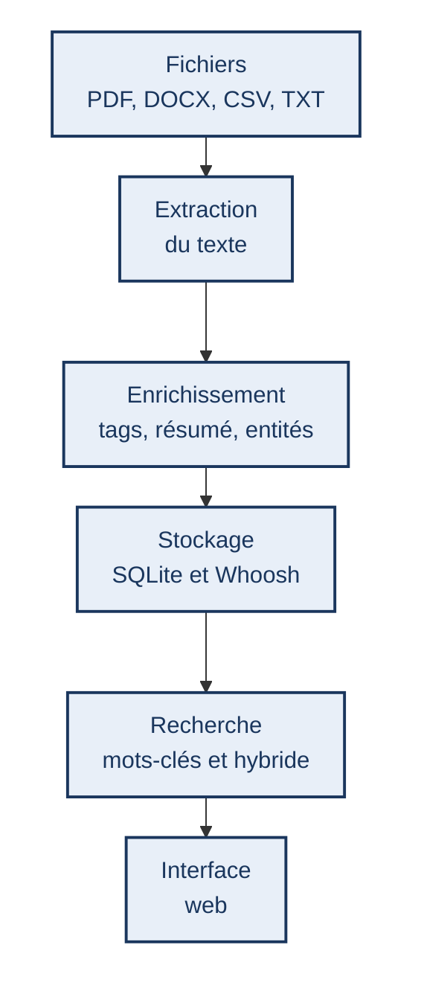

# Figure 1. Pipeline d’indexation intelligente

À coller dans [Mermaid Live](https://mermaid.live) ou à prévisualiser dans Cursor, puis exporter en PNG pour le Word (`rapport/figures/fig1_pipeline.png`).

