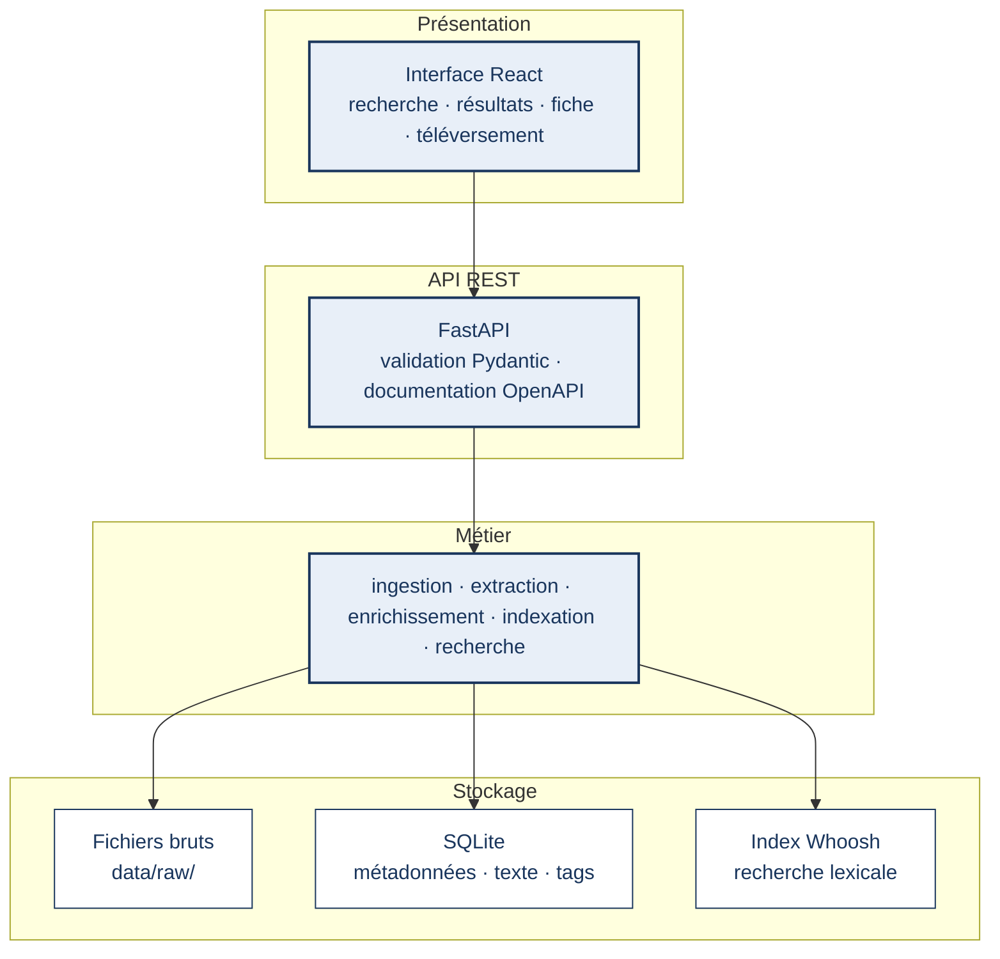

# Figure 2. Architecture logique de DocSearch

À coller dans [Mermaid Live](https://mermaid.live) ou à prévisualiser dans Cursor, puis exporter en PNG pour le Word (`rapport/figures/fig2_architecture.png`).

Le client n’accède jamais directement à l’index : toute requête passe par l’API.

