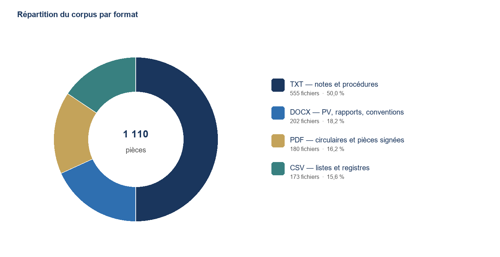
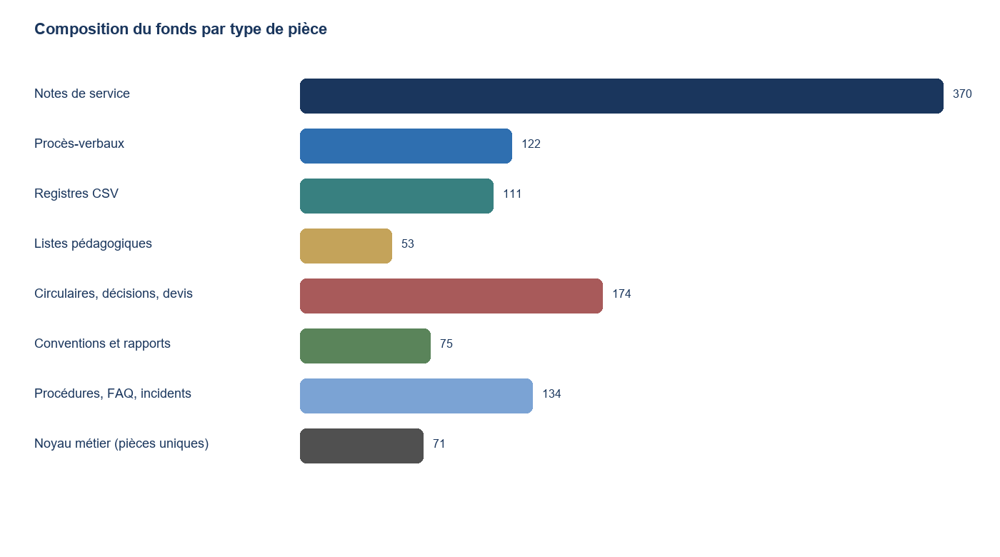
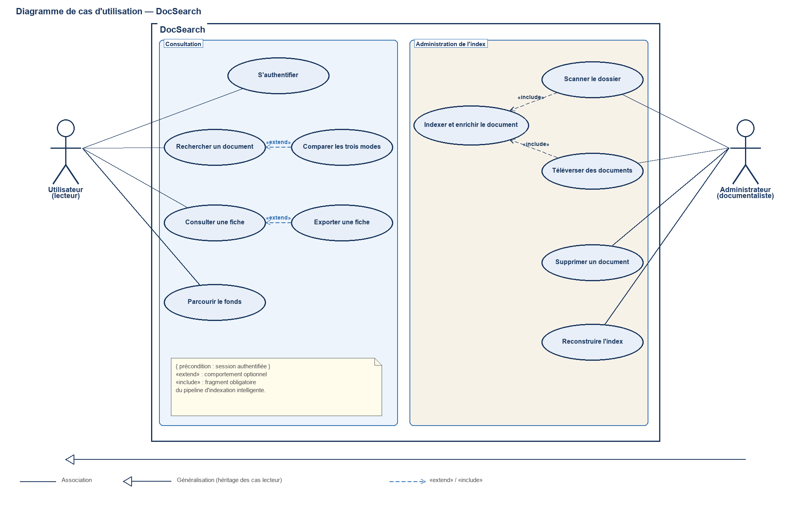
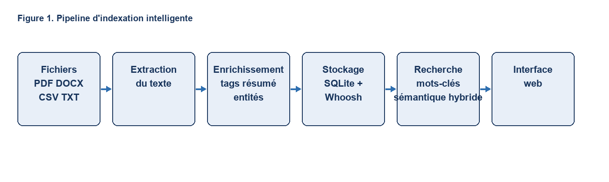
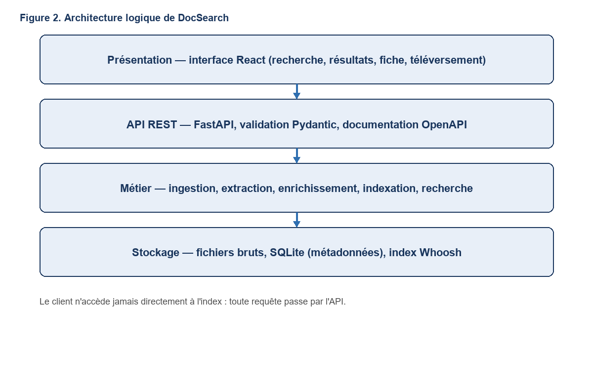
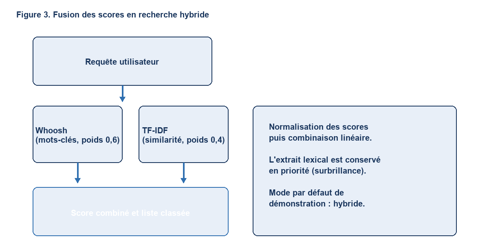
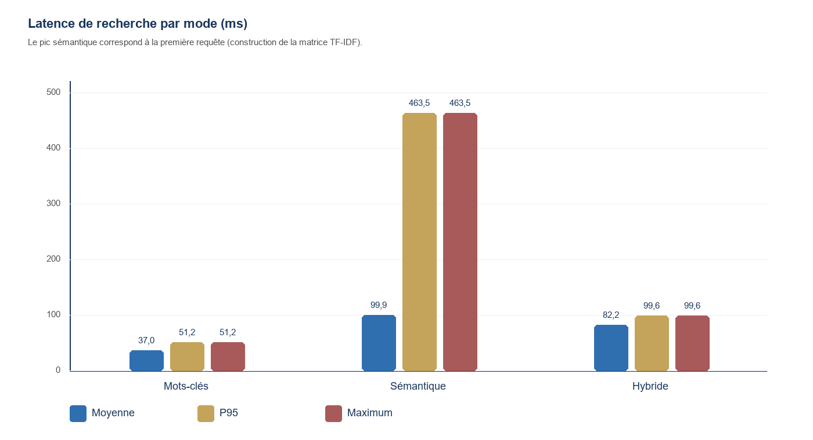
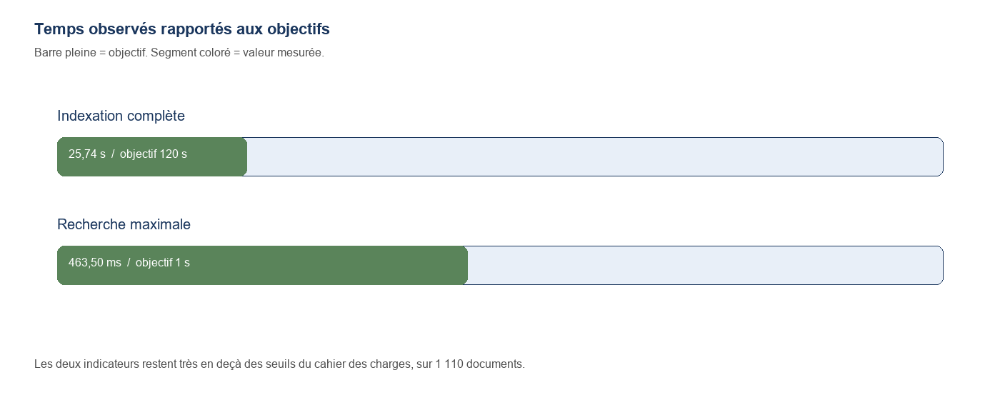
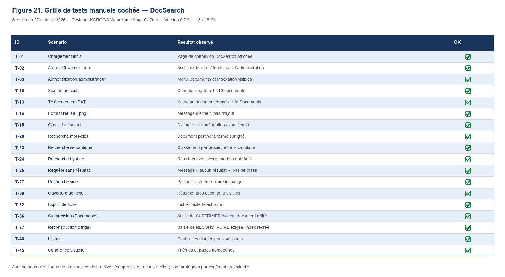

# INTRODUCTION GÉNÉRALE

## 1. Contexte et motivation

Notes de service, rapports d’activité, procédures, tableaux budgétaires, comptes rendus et correspondances s’accumulent dans les organisations. Dans une école, une administration locale, une ONG ou une PME, ces fichiers se dispersent entre dossiers personnels, clés USB et partages réseau. Le contenu est disponible, mais le retrouver ne l’est pas : il faut ouvrir les pièces une à une, lancer « Rechercher dans le document » ou parcourir l’explorateur. Ce désordre d’accès n’est pas qu’un problème d’organisation. Il pose aussi une question scientifique. La recherche d’information (RI) a pour objet de retrouver, dans une collection, les documents pertinents vis-à-vis d’un besoin exprimé par une requête. Un système de RI suppose une collection, une requête, un mécanisme de classement et une notion de pertinence. Or beaucoup d’outils du quotidien offrent une barre de recherche sans constituer un moteur au sens de la RI. Ils parcourent le contenu au moment de la requête, sans structure préparée, sans classement par pertinence et sans enrichissement du document.

Les moteurs industriels, comme Elasticsearch ou Solr, et les approches récentes par index vectoriel ou recherche générative convergent sur un point. La qualité des résultats dépend d’abord de l’indexation. Il faut extraire le contenu, l’enrichir, le stocker dans une structure interrogeable, puis croiser plusieurs signaux de pertinence. Ces solutions restent toutefois trop lourdes pour une petite structure. Le coût de l’infrastructure, les compétences d’exploitation et la dépendance à un cluster ou à un processeur graphique les rendent disproportionnées.

Dans un contexte à ressources limitées, il devient pertinent de concevoir un système local. Ce système doit pouvoir être démontré et installé sans infrastructure lourde. Il repose explicitement sur une indexation intelligente. Ce mémoire a été préparé dans le cadre du Master informatique de l’Institut burkinabè des arts et métiers (IBAM), option Ingénierie des systèmes d’information en entreprise. Le thème retenu est l’indexation intelligente de données pour la recherche d’information.

La motivation est donc double. Sur le plan scientifique, il s’agit de clarifier ce qu’est un index, ce qu’on peut y mettre, et ce que la littérature récente en a fait. Sur le plan pratique, il s’agit de montrer qu’une petite organisation peut disposer d’un outil local. Cet outil ne suppose ni cluster ni processeur graphique. Le cas de démonstration s’inspire d’une direction de documentation. Il donne un cadre concret à cette exigence.

La solution que nous proposons se nomme DocSearch. C’est un portail web local. Il ingère des PDF, des documents Word, des fichiers CSV et des textes. Il enrichit chaque pièce par des tags, un résumé et des entités. La recherche se fait par mots-clés, en mode sémantique ou en mode hybride. Ce portail ne vise pas à remplacer Google, Elasticsearch ou un assistant conversationnel. Il doit rendre visible, dans un prototype défendable à l’oral, le lien entre une indexation préparée et la qualité de la recherche.

## 2. Problématique et hypothèses

La recherche par parcours de fichiers ou par mots-clés seuls ne permet pas toujours de retrouver efficacement l’information, surtout lorsque les documents sont nombreux, hétérogènes et formulés de manières différentes. Les moteurs d’entreprise restent souvent trop lourds pour une petite organisation.

La problématique de ce mémoire est donc la suivante : **comment concevoir un système local de recherche d’information fondé sur une indexation intelligente, alors que beaucoup d’outils de « recherche » n’indexent pas réellement le contenu ?**

Cette question sera précisée par quatre orientations : distinguer recherche sans index et recherche avec index ; identifier les apports transférables de la littérature récente ; concevoir un pipeline d’ingestion, d’enrichissement, d’indexation et de recherche ; évaluer la faisabilité de la solution sur un corpus de test.

Nous formulons l’hypothèse générale suivante : une indexation intelligente, c’est-à-dire une extraction multi-formats, un enrichissement et la combinaison d’un index lexical avec un signal de similarité, améliore la pertinence de la recherche locale par rapport à une recherche sans index ou fondée uniquement sur les mots-clés.

Deux hypothèses de travail précisent cette idée.

- **H1.** Une recherche documentaire efficace suppose un index préparé ; le parcours des fichiers à la requête ne suffit pas.
- **H2.** Un index enrichi, combiné à une recherche hybride, rend les résultats plus exploitables qu’un index lexical seul, même sans processeur graphique.

Ces hypothèses structurent la conception et l’interprétation des expérimentations. Elles ne prétendent pas, dans le cadre d’un master, à une évaluation IR complète de type TREC.

## 3. Objectifs

L’objectif général est de concevoir, d’implémenter et d’évaluer un système local d’indexation intelligente de données au service de la recherche d’information, en le situant par rapport aux moteurs existants et à la littérature scientifique récente.

Pour atteindre cet objectif général, le travail s’articule autour des objectifs spécifiques suivants :

- distinguer théoriquement la recherche sans index et la recherche avec index ;
- analyser les moteurs existants et la littérature récente sur l’indexation intelligente ;
- concevoir un pipeline d’ingestion, d’extraction, d’enrichissement, d’indexation et de recherche ;
- développer un prototype local capable de traiter plusieurs formats (PDF, DOCX, CSV, TXT) et d’offrir une recherche par mots-clés ou sémantique ;
- évaluer la solution sur un corpus de test et en dégager les limites et les perspectives.

## 4. Organisation du mémoire

Le mémoire suit le canevas des mémoires de Master informatique de l’IBAM.

L’**introduction générale** situe le thème, formule la problématique et les hypothèses, énonce les objectifs et présente l’organisation du document.

Le **chapitre 1** présente les concepts fondamentaux et l’état de l’art : recherche d’information, indexation, distinction sans index et avec index, moteurs existants, travaux scientifiques récents, synthèse et positionnement.

Le **chapitre 2** expose la méthodologie et l’analyse des besoins : démarche, corpus, exigences, architecture et choix technologiques.

Le **chapitre 3** décrit la conception et l’implémentation de DocSearch : organisation logicielle, extraction, enrichissement, indexation, modes de recherche, API et interface. Les algorithmes correspondants sont détaillés en **annexe I** ; les extraits de code figurent en **annexe J**.

Le **chapitre 4** présente l’expérimentation, les résultats, leur discussion, les limites et les perspectives.

La **conclusion générale** dresse le bilan du travail. Une **bibliographie**, une **webographie** et des **annexes** (installation, API, corpus, tests, algorithmes et extraits de code de la logique métier) complètent le document.

# CHAPITRE 1. CONCEPTS FONDAMENTAUX ET ÉTAT DE L’ART

## 1.1. Introduction

La recherche documentaire occupe une place centrale dans les systèmes d’information, puisqu’elle donne accès aux documents répondant aux besoins des utilisateurs. L’augmentation du volume de fichiers numériques et la diversité des formulations limitent toutefois l’efficacité des outils qui se contentent de parcourir les dossiers. Ce chapitre clarifie d’abord les notions de recherche d’information et d’indexation. Il distingue ensuite la recherche sans index de la recherche avec index, présente les méthodes classiques, cartographie les moteurs existants et synthétise des travaux scientifiques récents. Il se clôt par le positionnement du présent mémoire.

## 1.2. Recherche d’information et indexation

Dans ce mémoire, rechercher une information, c’est retrouver dans un fonds les pièces qui répondent à la question posée par l’utilisateur (Manning, Raghavan et Schütze, 2008). Quatre éléments suffisent à décrire un tel système : le fonds, la requête, un ordre de présentation des réponses, et un jugement sur ce qui est utile. La précision, le rappel, le rang réciproque moyen et le nDCG servent ensuite à chiffrer cette utilité. Ils seront repris au chapitre 4, sans campagne de type TREC.

Le geste décisif n’est pas de ranger les fichiers dans des dossiers. C’est de les transformer, avant toute question, en une structure consultable. L’index inversé est à la base des moteurs lexicaux. Pour chaque mot, il garde la liste des documents qui le contiennent. Sans cette liste, DocSearch devrait rouvrir le millier de fichiers du corpus à chaque requête.

Les méthodes utilisées ensuite sont connues. Il s’agit des mots-clés, de l’index inversé, du TF-IDF, de BM25 et des opérateurs booléens. Elles classent bien si la requête reprend les mots du document. Elles manquent la question formulée avec d’autres termes. Cette limite justifiera, plus loin, un second signal de similarité.

Whoosh reprend, dans le prototype, l’enchaînement classique de construction. On acquiert le fichier. On le découpe en termes. On peut écarter les mots grammaticaux. On peut aussi ramener les formes à une racine. Chaque terme pointe vers les documents où il figure, et souvent vers ses positions. À la requête, le moteur ne relit plus le fonds. Il croise les listes, calcule un score et ordonne les réponses.

Le TF-IDF sert à ne pas traiter tous les mots de la même façon (Salton et Buckley, 1988 ; Spärck Jones, 1972). Un terme pèse d’autant plus qu’il revient dans le document et qu’il est rare dans le reste du fonds :

**TF-IDF(t, d) = tf(t, d) × log(N / df(t))**

tf(t, d) compte les occurrences de t dans d ; df(t) compte les documents du fonds qui contiennent t ; N est la taille du fonds. Dans le corpus de l’IBAM, un mot comme « document » apparaît presque partout et pèse peu. Un mot plus localisé, comme « archivage » ou « délibération », pèse davantage.

BM25 affine le TF-IDF sur deux points (Robertson et Zaragoza, 2009). D’abord, la fréquence sature : répéter un mot dix fois ne le rend pas dix fois plus informatif. Ensuite, la longueur du document est prise en compte, pour ne pas avantager les textes les plus longs. Le modèle reste lexical. Deux notes qui disent la même chose avec des mots différents peuvent donc rester éloignées. Whoosh utilise BM25 pour le mode mots-clés. Le mode hybride ajoute un second score pour compenser cette limite.

Quatre indicateurs servent à juger un classement. La précision à k (Precision@k) compte, dans les k premières réponses, combien sont pertinentes. Le rappel à k (Recall@k) compte, parmi les documents pertinents du fonds, combien figurent dans ces k rangs. Le rang réciproque moyen (MRR) valorise le fait de placer le premier bon document le plus haut possible. Le nDCG va plus loin : il tient compte de l’ordre, et aussi du fait que certaines pièces sont plus utiles que d’autres. Le chapitre 4 rappellera ces indicateurs. Le prototype de master ne mènera pas une campagne exhaustive sur une collection annotée.

## 1.3. Recherche sans index et recherche avec index

Cette distinction évite de confondre une interface de recherche et un moteur de recherche.

Sans index, le système ouvre les fichiers au moment de la question. C’est le cas du Ctrl+F, de l’explorateur, de l’opérateur SQL LIKE ou d’une recherche sur le nom du fichier. La méthode est simple. Le temps augmente pourtant avec le volume. Le classement reste pauvre. Aucun enrichissement n’est préparé à l’avance.

Avec index, la structure est construite avant les requêtes. Elle peut comprendre un index inversé, une table de métadonnées et, parfois, des représentations de similarité. La recherche devient plus rapide et plus pertinente. Le prix à payer est un pipeline d’ingestion et une politique de mise à jour.

La question scientifique n’est donc plus « faut-il un index ? », mais « que contient l’index et comment est-il construit ? »

Tableau 1. Synthèse de la recherche sans index, avec index lexical et avec une indexation plus intelligente

| Critère | Sans index | Avec index lexical | Indexation plus intelligente |
|---------|------------|--------------------|------------------------------|
| Travail lourd | À chaque requête | À l’ingestion | Idem, plus enrichissement |
| Objet interrogé | Fichiers ou chaînes | Termes | Termes, métadonnées, similarité |
| Pertinence | Faible | TF-IDF, BM25 | Hybride, annotations |
| Exemples | Ctrl+F, grep, LIKE | Lucene, Whoosh | Systèmes hybrides, index enrichi |

## 1.4. Indexation intelligente

Nous appelons indexation intelligente une indexation qui ne se limite pas aux termes bruts. Elle peut ajouter des métadonnées, des annotations (tags, entités, résumés) et des représentations de sens. Ici, l’intelligence ne se confond pas avec un grand modèle de langage. Elle tient à la richesse de ce qui est préparé avant la requête. Elle tient aussi à la combinaison de plusieurs signaux de pertinence.

La littérature récente confirme cette orientation. Clarke (2024) insiste sur l’index annoté. Dadopoulos et al. (2025) montrent l’intérêt des métadonnées riches. Pérez et Vizcaino (2024) rappellent que la qualité de l’index dépend d’abord de l’extraction du texte. Les approches génératives (GenIR) seront citées comme état de l’art, mais non retenues pour le prototype, trop coûteuses pour un système local de master.

## 1.5. Moteurs et plateformes existants

Les outils ci-dessous illustrent où se situe l’indexation dans l’écosystème réel. Ils ne sont pas tous des concurrents d’un prototype académique.

Tableau 2. Moteurs et plateformes existants

| Famille | Exemples | Apport | Limite vis-à-vis du thème |
|---------|----------|--------|---------------------------|
| Moteurs du Web | Google, Bing | Index mondial, ranking sophistiqué | Corpus public, pas d’archives locales |
| Moteurs d’entreprise | Elasticsearch, Solr, OpenSearch | Vrai index, facettes, montée en charge | Infrastructure et compétences |
| Moteurs embarqués | Lucene, Whoosh, SQLite FTS, Meilisearch | Index local sans data center | Souvent lexicaux, sans enrichissement |
| Index vectoriels et RAG | FAISS, Qdrant, assistants RAG | Signal sémantique | Coût, GPU, attention déplacée vers le chat |
| Stockage | Drive, Nextcloud, explorateur | Recherche sur noms ou dossiers | Pas une RI documentaire enrichie |

Elasticsearch a été écarté pour le prototype : trop lourd à exploiter dans le cadre du mémoire. Les embeddings neuronaux de type BERT restent une perspective. Le travail s’oriente vers un moteur embarqué, une persistance légère et un signal de similarité calculable sur processeur central.

## 1.6. Travaux scientifiques récents (2022–2026)

Le corpus de lecture comprend quinze articles, organisés en quatre familles. Chaque famille est d’abord présentée, puis discutée au regard des objectifs du mémoire.

### 1.6.1. Index enrichi et unifié

Clarke (2024) propose l’indexation annotative. Le contenu n’est plus seulement une liste de termes. Il est d’abord placé dans un espace d’adresses. Il est ensuite enrichi d’annotations : segmentation, entités, scores et vecteurs. Ce cadre cherche à réunir des structures souvent séparées, comme l’index inversé, les colonnes, les objets et les graphes. Pour notre travail, l’apport n’est pas l’architecture complète de Clarke, trop vaste pour un prototype, mais l’idée que l’intelligence de l’index se joue dans ce que l’on ajoute au texte brut.

Jagini et al. (2024) traitent des JSON scientifiques dont le schéma varie. L’indexation cell-centric rend chaque valeur ou paire clé-valeur interrogeable, via Elasticsearch, sans schéma unique connu à l’avance. L’enseignement retenu est méthodologique : l’unité d’indexation doit être choisie. Dans DocSearch, l’unité retenue est le document enrichi, après unification des formats.

**Limite vis-à-vis du thème.** Ces cadres sont puissants, mais restent conceptuels (Clarke, 2024) ou spécialisés (données scientifiques). Ils ne livrent pas un portail local pour des archives administratives PDF et DOCX.

### 1.6.2. Index appris et recherche générative

Tay et al. (2022) introduisent le *Differentiable Search Index* (DSI). La mémoire d’un Transformer y remplace en partie l’index externe. La recherche devient alors une génération d’identifiants de documents. Wang et al. (2022) proposent le *Neural Corpus Indexer* (NCI). Ce modèle associe une requête à un identifiant sémantique. Zhang et al. (2024) synthétisent ce passage du matching à la génération (GenIR) et en soulignent les coûts, les difficultés de mise à jour et les questions d’échelle. Yang et al. (2023), avec ASI, s’intéressent aux documents nouveaux. Lee et al. (2023), avec GLEN, visent des identifiants plus interprétables.

**Limite vis-à-vis du thème.** Ces travaux seront cités comme état de l’art, non comme architecture du prototype. Leur besoin de GPU, de réentraînement et de corpus stables dépasse le périmètre d’un système local de master. Ils montrent toutefois que l’index est devenu un objet de recherche à part entière, et non un simple fichier annexe.

### 1.6.3. Hybridation des moteurs

HetaRAG (KnowledgeXLab, 2025) part du constat qu’un seul index ne suffit plus. Les vecteurs portent le sens, le plein texte retrouve les termes exacts, les graphes portent les relations et les bases relationnelles gardent la structure. Le système route la requête vers le bon magasin, puis fusionne les preuves. La qualité de cette récupération conditionne ensuite la réponse générée.

Gollapudi et al. (2024) traitent un cas plus précis avec ACORN. La requête mêle une similarité vectorielle et un filtre, comme une catégorie ou une date. ACORN étend l’index HNSW pour appliquer ce filtre pendant le parcours, et non après. La similarité et les métadonnées ne restent donc pas séparées jusqu’au dernier moment.

Chuang et al. (2023) proposent DiscoverPath pour des articles biomédicaux dont le vocabulaire change d’un domaine à l’autre. Les résumés deviennent un graphe d’entités et de relations. L’utilisateur ne voit qu’un sous-graphe centré sur sa requête, avec des suggestions pour l’affiner.

**Limite vis-à-vis du thème.** Ces architectures restent lourdes pour un prototype local : plusieurs magasins, un index HNSW ou un graphe de connaissances. DocSearch en retient une idée plus modeste. Il combine un signal lexical et un signal de similarité, renforcés par les tags, sans orchestrateur multi-magasins.

### 1.6.4. Amont : ingestion, vision, granularité, métadonnées

Cette famille déplace le problème en amont de la requête. Un index, même bien conçu, ne retrouve que ce que l’ingestion a su lire.

Pérez et Vizcaino (2024) le montrent sur les systèmes de génération augmentée. Si l’extraction, le parsing ou la structuration échouent, la recherche qui suit échoue aussi. L’ingestion doit donc s’adapter au type de document, et non appliquer un traitement unique.

Faysse et al. (2024), avec ColPali, et Yu et al. (2024), avec VisRAG, poussent l’idée plus loin. Une page n’est pas seulement son texte : tableaux, figures et mise en page portent une information que l’OCR perd. Ils indexent donc la page comme image, grâce à un modèle vision-langage. Le gain est réel sur les documents multimodaux. Le coût l’est aussi.

Zhong et al. (2024) rappellent qu’un texte bien extrait peut encore être mal découpé. Un passage trop court perd le contexte. Un passage trop long noie l’information utile. La taille de l’unité d’indexation est donc un choix de conception.

Dadopoulos et al. (2025) ferment l’argument sur des rapports financiers longs, où l’information est dispersée. Des métadonnées riches, résumés, entités et thèmes, améliorent la recherche plus sûrement qu’un simple reclassement final. Ce qui entoure le texte brut compte autant que le texte lui-même.

**Limite vis-à-vis du thème.** Pour un prototype local, sans processeur graphique, trois voies restent hors de portée : l’OCR avancé, les modèles vision-langage et le découpage des passages qui change à chaque requête. Deux enseignements restent transférables : soigner l’extraction multi-formats, et enrichir le document avant la requête. C’est le cœur de l’indexation retenue pour DocSearch.

### 1.6.5. Lecture article par article

Pour rendre l’état de l’art vérifiable, chaque article du corpus de lecture est résumé ci-dessous, puis situé par rapport au prototype.

Clarke (2024) part d’un fait simple. Les collections mêlent aujourd’hui texte, JSON, CSV, HTML et PDF. Aucun outil unique ne les stocke et ne les recherche ensemble. Son indexation annotative place d’abord le contenu dans un espace d’adresses, puis l’enrichit. Notre solution ne reprend pas ce cadre unificateur, trop vaste pour le prototype. Elle en garde l’exigence utile : entourer le texte d’annotations, sous forme de tags, de résumé et d’entités.

Jagini et al. (2024) montrent qu’un JSON scientifique au schéma variable reste interrogeable si l’on indexe au grain de la cellule. L’enseignement pour ce mémoire est que l’unité d’indexation est un choix. Nous indexons le document après unification des formats, ce qui est plus simple, mais suffisant pour un corpus administratif.

Tay et al. (2022) proposent de supprimer l’index comme fichier séparé. Un grand modèle, un Transformer, apprend le lien entre une question et le numéro du document qui y répond. À la requête, il ne consulte plus une liste de termes : il produit directement cet identifiant. La recherche devient donc une génération. L’idée n’est pas retenue ici. L’entraîner demande beaucoup de calcul, et chaque document nouveau obligerait presque à tout réapprendre. DocSearch, lui, ajoute un fichier en mettant à jour Whoosh, sans réentraînement.

Wang et al. (2022) réunissent indexation et classement dans un réseau séquence-à-séquence, le Neural Corpus Indexer (NCI). Pour eux, la façon de représenter les documents dans l’index pèse autant que l’algorithme de recherche. Nous en gardons une version minimale. Le titre, les tags et le contenu alimentent à la fois Whoosh et le TF-IDF.

Zhang et al. (2024) décrivent le passage du rapprochement de termes à la génération. Leur synthèse rappelle trois obstacles : le coût, la mise à jour du corpus et le passage à l’échelle. Elle sert ici de garde-fou. Un prototype local ne doit pas être présenté comme une solution de recherche générative.

Yang et al. (2023) s’attaquent aux identifiants de documents qui ne s’adaptent pas aux fichiers nouveaux. Lee et al. (2023) cherchent des identifiants plus interprétables (GLEN). Ces deux articles confirment qu’un index figé vieillit. DocSearch répond à cette contrainte par une empreinte, un scan incrémental et une reconstruction d’index, sans apprentissage de docids.

HetaRAG (KnowledgeXLab, 2025) formalise la combinaison de plusieurs magasins. ACORN (Gollapudi et al., 2024) combine vecteurs et prédicats structurés. DiscoverPath (Chuang et al., 2023) ajoute un graphe. Le transfert retenu est la fusion de deux listes, lexicale et sémantique, avec un boost de tags, et non un orchestrateur multi-stores.

Pérez et Vizcaino (2024) placent l’ingestion au centre : un mauvais parsing ruine l’aval. ColPali (Faysse et al., 2024) et VisRAG (Yu et al., 2024) indexent la page comme image. Zhong et al. (2024) montrent que la taille des passages est un levier. Dadopoulos et al. (2025) montrent que des métadonnées riches battent souvent un reranker isolé. Ces cinq articles justifient, dans le prototype, l’effort mis sur l’extraction multi-formats et sur l’enrichissement, plutôt que sur un modèle de langage génératif.

Tableau 3. Corpus de lecture 2022–2026

| Jour | Articles | Orientation |
|------|----------|-------------|
| 1 | Clarke ; Jagini et al. ; Tay et al. ; Wang et al. ; Zhang et al. | Index enrichi, GenIR |
| 2 | Yang et al. ; Lee et al. ; HetaRAG ; Gollapudi et al. ; Chuang et al. | Identifiants, hybridation |
| 3 | Pérez et Vizcaino ; Faysse et al. ; Yu et al. ; Zhong et al. ; Dadopoulos et al. | Ingestion, vision, métadonnées |

## 1.7. Synthèse et positionnement

L’état de l’art conduit à six choix. On distingue d’abord la recherche sans index de la recherche avec index : la structure se prépare avant la requête. On extrait plusieurs formats, parce que les fonds réels mêlent PDF, Word, tableaux et texte. L’enrichissement se fait sans processeur graphique. L’index reste local, plutôt que de déployer un moteur d’entreprise. On combine un signal lexical et un signal de similarité léger. L’évaluation porte enfin sur la faisabilité et la performance, dans le cadre d’un prototype de master.

Notre solution se place parmi les systèmes à index. Elle ne cherche pas à rivaliser avec Google, ni avec la recherche générative. Elle reprend quatre idées de la littérature et les réalise en local : un index lexical embarqué, des métadonnées conservées à côté du texte, un enrichissement déterministe et une recherche hybride légère. L’apport est une démonstration cohérente. Elle montre qu’une indexation intelligente tient dans un contexte à ressources limitées.

Tableau 4. Positionnement par rapport à l’état de l’art

| Idée de l’état de l’art | Traduction dans ce mémoire |
|-------------------------|----------------------------|
| Nécessité d’un index | Index Whoosh et métadonnées SQLite |
| Enrichissement (Clarke, Dadopoulos) | Tags, résumé extractif, entités |
| Ingestion (Pérez) | Extracteurs PDF, DOCX, CSV, TXT |
| Hybridation (HetaRAG, ACORN) | Modes mots-clés, sémantique, hybride |
| GenIR et vision | Cités comme perspectives |

## 1.8. Conclusion du chapitre

Ce chapitre a montré qu’une recherche d’information efficace repose sur une indexation préparée. L’indexation intelligente consiste à enrichir cette préparation. Elle n’exige pas un grand modèle de langage. Les moteurs existants confirment le besoin d’un index. Leur coût reste souvent incompatible avec une petite organisation. La littérature récente ouvre trois voies transférables en local : les annotations, l’hybridation et le soin de l’ingestion. Le chapitre suivant décrit la démarche retenue pour concevoir une telle solution.

# CHAPITRE 2. MÉTHODOLOGIE ET ANALYSE DES BESOINS

## 2.1. Introduction

Le chapitre 1 a situé l’indexation intelligente parmi les systèmes qui préparent une structure avant la requête. Il reste à dire comment cette idée devient une solution concevable, dans le cadre d’un master et d’une petite organisation. Le présent chapitre ne décrit pas encore le code. Il fixe la démarche, les besoins et les choix qui commanderont la réalisation.

La démarche est celle d’une étude appliquée. On conçoit une solution, on la réalise, puis on mesure son comportement sur un corpus défini. Ce corpus est un fonds de démonstration. Il mêle plusieurs formats et s’ancre dans le centre de documentation de l’IBAM. Les exigences suivent le parcours d’un fichier, de l’extraction jusqu’à la recherche. Deux acteurs les portent : le lecteur, qui consulte, et l’administrateur, qui alimente l’index.

De ce parcours découle une architecture en couches, du portail jusqu’au stockage. Chaque outil est choisi en tenant compte de l’état de l’art et des moyens d’une petite structure. Le chapitre indique enfin comment la solution sera jugée : les fonctions couvertes, le temps de réponse et la qualité perceptible des résultats. Le détail de la programmation viendra au chapitre 3.

## 2.2. Démarche méthodologique

La méthode retenue est celle du prototype. Le système est d’abord spécifié, ensuite programmé, enfin observé sur un ensemble de documents connu à l’avance. Cette suite reprend le cycle d’un travail d’ingénierie : besoins, architecture, réalisation, essais, lecture des résultats. L’étude bibliographique ouvre ce cycle.

Côté traitement, la requête n’ouvre pas les fichiers. L’arrivée d’une pièce déclenche une chaîne fixe. Une empreinte indique si le fichier a déjà été traité. Le texte en est tiré, des annotations y sont ajoutées, la fiche est stockée et l’index est mis à jour, ainsi que le calcul de similarité. Une question posée plus tard ne dispose plus que de ces préparations : les listes de termes, et les vecteurs TF-IDF.

Les étapes suivies dans le mémoire sont les suivantes.

1. Étude bibliographique et clarification des concepts de RI.
2. Analyse des moteurs existants et des articles 2022–2026.
3. Formulation de la problématique, des hypothèses et des objectifs.
4. Collecte et préparation d’un corpus multi-formats.
5. Conception de l’architecture et des exigences.
6. Développement du prototype DocSearch.
7. Tests fonctionnels, mesures de performance et analyse qualitative.
8. Discussion des limites et rédaction du mémoire.

## 2.3. Corpus documentaire

Le corpus est un jeu de démonstration ancré dans le **centre de documentation de l’IBAM** (Université Joseph Ki-Zerbo). Il simule des documents administratifs et pédagogiques : procédures, notes de service, délibérations, rapports d’activité, documents budgétaires, listes d’étudiants, catalogues de formation et FAQ. Il mélange volontairement plusieurs formats (PDF, DOCX, CSV, TXT) afin de tester l’hétérogénéité en entrée.

Le corpus compte **1 110 fichiers** (555 TXT, 173 CSV, 202 DOCX, 180 PDF), répartis sur les années 2020 à 2026. Ce volume se rapproche du rythme d’un centre de documentation universitaire : notes de service, procès-verbaux, circulaires, registres, listes pédagogiques, devis et rapports. Les pièces restent des reconstitutions pédagogiques : le cadre institutionnel (IBAM, UJKZ, filières, adresses) est réel ; les personnes, délibérations et montants sont fictifs, afin de maîtriser le droit et la confidentialité. La génération est reproductible (`scripts/generate_demo_dataset.py`).

Les figures 23 et 24 rendent visible cette hétérogénéité : d’un côté les quatre formats d’entrée, de l’autre les familles de pièces qui composent le fonds.





## 2.4. Acteurs et exigences

Deux acteurs internes suffisent à décrire le périmètre fonctionnel. Ils partagent le **même portail** : le lecteur consulte l’espace public sans connexion ; l’administrateur s’authentifie pour maintenir l’index. Un troisième profil, l’étudiant-concepteur, maintient le prototype hors de l’application.

L’**utilisateur** (lecteur) interroge le fonds, consulte une fiche document, parcourt le catalogue, compare les trois modes de recherche et peut exporter une fiche, sans s’authentifier. Il n’administre pas l’index.

L’**administrateur** (documentaliste ou informaticien) hérite des cas de consultation. Il dépose en outre des fichiers (import unitaire ou multiple), lance une réindexation, consulte le tableau de bord et peut supprimer un document.

Le problème à traiter n’est pas le stockage : les fichiers existent déjà. C’est l’accès par le contenu, via une indexation préparée.

Le cas de démonstration s’ancre dans le centre de documentation de l’IBAM. Les documents de formation, de budget, de procédures et de comptes rendus sont dispersés. L’utilisateur doit pouvoir formuler une requête simple (« formation », « budget », « procédure d’archivage ») et obtenir une liste classée, puis ouvrir une fiche montrant un résumé et des tags. L’administrateur doit pouvoir déposer un fichier ou scanner un dossier sans reconstruire manuellement l’index.

Ces rôles sont représentés dans le diagramme de cas d’utilisation (figure 4). Le schéma est structuré en deux paquets UML : la consultation et l’administration de l’index. Les relations «extend» portent les comportements optionnels (comparer les trois modes, exporter une fiche). Les relations «include» rattachent le scan et le téléversement au cas « indexer et enrichir le document », qui matérialise le pipeline d’indexation intelligente. Une contrainte de précondition impose une session administrateur uniquement pour les cas d’administration ; la consultation reste publique. L’administrateur hérite des cas du lecteur par généralisation.



Tableau 5. Exigences fonctionnelles de DocSearch

| Identifiant | Exigence fonctionnelle | Acteur principal |
|-------------|------------------------|------------------|
| EF1 | Ingérer des fichiers depuis un dossier local | Administrateur |
| EF2 | Téléverser un ou plusieurs fichiers via l’interface | Administrateur |
| EF3 | Extraire le texte de PDF, DOCX, CSV et TXT | Système |
| EF4 | Enrichir chaque document (tags, résumé, entités, catégorie) | Système |
| EF5 | Persister métadonnées et contenu extractible | Système |
| EF6 | Construire et mettre à jour un index de recherche | Système |
| EF7 | Rechercher en mode mots-clés, sémantique ou hybride | Utilisateur |
| EF8 | Afficher une liste classée et une fiche enrichie | Utilisateur |
| EF9 | Exposer une API REST documentée | Système |
| EF10 | Supprimer un document de la base et de l’index | Administrateur |
| EF11 | S’authentifier en administrateur pour indexer et maintenir le fonds | Administrateur |
| EF12 | Comparer les trois modes de recherche | Utilisateur |

Tableau 6. Exigences non fonctionnelles de DocSearch

| Identifiant | Exigence non fonctionnelle | Cible |
|-------------|----------------------------|-------|
| ENF1 | Fonctionnement local, sans cluster obligatoire | Local-first |
| ENF2 | Indexation d’une centaine de documents | < 2 minutes |
| ENF3 | Temps de recherche sur le corpus de test | < 1 seconde |
| ENF4 | Architecture modulaire et tests automatisés | Maintenabilité |
| ENF5 | Enrichissement explicable, sans boîte noire | Interprétabilité |
| ENF6 | Stack Python et React | Portabilité académique |

Hors périmètre du prototype : annuaire LDAP ou authentification unique (SSO), millions de documents, OCR robuste des PDF scannés, génération de réponses de type assistant conversationnel, connecteurs distants (messagerie, SharePoint). Une authentification locale de l’administrateur, avec un espace public de consultation, est en revanche prévue dans le prototype.

## 2.5. Architecture fonctionnelle

L’architecture est organisée en couches. La présentation est une interface React. L’API, réalisée avec FastAPI, expose les contrats REST. La couche métier comprend l’ingestion, l’extraction, l’enrichissement, l’indexation et la recherche. Le stockage associe les fichiers bruts, une base SQLite et un index Whoosh.

Un fichier suit toujours le même sens. L’interface, ou un dossier local, le remet à l’API. La couche métier en extrait le texte, l’enrichit, puis le confie au stockage. Le fichier d’origine reste dans un répertoire. SQLite conserve la fiche : texte, tags, résumé et entités. Whoosh conserve l’index inversé, celui que la recherche lexicale consulte. Les trois sont reliés par l’identifiant du document. La figure 2 montre cette chaîne, de l’arrivée du fichier jusqu’à l’écran.



Le pipeline dit dans quel ordre le document est traité. Il ne dit pas encore qui appelle qui. Les mêmes étapes sont donc replacées dans des couches. L’interface ne touche jamais l’index : toute demande passe par l’API. La couche métier exécute l’extraction, l’enrichissement, l’indexation et la recherche. Le stockage reste partagé en trois lieux, déjà vus dans la chaîne. La figure 3 montre cette organisation.



Chaque document est normalisé selon un schéma commun. L’hétérogénéité des formats est traitée à l’entrée du pipeline, et non dans l’interface de recherche.

Tableau 7. Modèle de données du document

| Champ | Rôle |
|-------|------|
| `id` | Identifiant unique du document |
| `title` | Titre affiché et champ surpondéré dans l’index |
| `content` | Texte extractible, base de la recherche |
| `source_path` | Chemin du fichier brut |
| `file_type` | Extension (pdf, docx, csv, txt) |
| `size_bytes` | Taille, affichée dans l’interface |
| `created_at`, `indexed_at` | Dates de création et d’indexation |
| `metadata` | Empreinte, entités, catégorie, détails d’extraction |
| `summary` | Résumé extractif |
| `tags` | Liste de mots-clés scorables |

## 2.6. Choix technologiques

Tableau 8. Choix technologiques du prototype

| Choix | Justification | Lien avec l’état de l’art |
|-------|---------------|---------------------------|
| FastAPI | API typée, documentation OpenAPI automatique | Séparation client et serveur |
| Whoosh | Index inversé embarqué, sans serveur dédié | Moteur à index, famille Lucene |
| SQLite | Fichier unique, suffisant pour un prototype | Métadonnées à côté de l’index |
| pdfplumber, python-docx, pandas | Extraction spécialisée par format | Ingestion (Pérez et Vizcaino) |
| scikit-learn TF-IDF | Similarité calculable sans GPU | Signal sémantique léger |
| spaCy optionnel et règles | Entités si un modèle français est présent | Enrichissement (Dadopoulos, Clarke) |
| React et Vite | Interface moderne | Accès unifié |

Whoosh a été retenu pour rester dans un seul environnement Python. Meilisearch aurait ajouté un service à part. Elasticsearch et les embeddings neuronaux sont laissés de côté pour le prototype. Ils demeurent des perspectives.

## 2.7. Dispositif d’évaluation

L’évaluation porte sur trois plans. La couverture fonctionnelle contrôle les formats, les modes de recherche, l’API et l’interface. La performance mesure le temps d’indexation et le délai de réponse. L’analyse qualitative regarde si les résultats sont exploitables : extraits, tags et résumé, sur des requêtes du métier.

La précision, le rappel et le MRR servent de cadre théorique. Les calculer sur une grande collection annotée n’est pas demandé pour valider le prototype. Ce calcul reste une perspective.

## 2.8. Conclusion du chapitre

La méthodologie retenue prépare le corpus avant la requête, enrichit les documents de manière déterministe et combine deux signaux de recherche dans un environnement local. L’architecture en couches et les choix technologiques découlent de l’état de l’art autant que des contraintes de ressources. Le chapitre suivant décrit la mise en œuvre de cette conception.

# CHAPITRE 3. CONCEPTION ET IMPLÉMENTATION DE LA SOLUTION

## 3.1. Introduction

Le chapitre 2 a arrêté la démarche, les besoins et les couches. Il reste à montrer que cette conception tient dans un programme. Le présent chapitre décrit la réalisation de DocSearch, prototype local, sans processeur graphique. Il ne reprend pas l’analyse des besoins. Il suit le fichier depuis son arrivée jusqu’à l’écran de recherche.

Le code est séparé en deux parties. Un backend Python porte l’ingestion, l’extraction, l’enrichissement, l’index et la recherche. Une interface React ne parle à ces fonctions que par l’API. L’environnement est celui d’un poste de développement : Python, Node.js, services en local. Aucun cluster n’est requis.

Le cœur du chapitre reste le traitement. Nous partons de l’extraction, qui lit les PDF, DOCX, CSV et TXT. L’enrichissement ajoute ensuite des tags, un résumé et des entités. Whoosh construit alors l’index lexical. Trois modes répondent enfin aux requêtes : mots-clés, similarité TF-IDF et hybride. L’interface affiche les résultats. Des tests automatisés et des scénarios manuels ferment la validation.

Les algorithmes 1 à 6 de l’annexe I détaillent l’ingestion, l’enrichissement et le classement. L’annexe J en donne les extraits Python. Le chapitre commente ces choix. Il ne recopie pas le code.

## 3.2. Organisation logicielle

Le backend est structuré en paquets Python. Le frontend est une application React distincte, qui ne communique avec l’index que par l’API.

Tableau 9. Organisation logicielle du projet

| Répertoire | Rôle |
|------------|------|
| `backend/app/api` | Routes REST |
| `backend/app/ingestion` | Scan de dossier et téléversement |
| `backend/app/extraction` | Extracteurs par format |
| `backend/app/intelligence` | Tags, résumé, entités, catégorie |
| `backend/app/indexing` | Index Whoosh |
| `backend/app/search` | Mots-clés, sémantique, hybride |
| `backend/app/models` | Schémas Pydantic |
| `frontend/src` | Interface React |
| `data/raw` | Corpus de démonstration |
| `backend/tests` | Tests automatisés |

Cette organisation rend chaque étape du pipeline identifiable, ce qui facilite les tests et la lecture pédagogique du code.

## 3.3. Environnement de développement

Le prototype a été développé sur un poste Windows, avec Python 3.10 ou supérieur et Node.js 18 ou supérieur. Aucun GPU n’est requis. L’API écoute en local, typiquement sur le port 8010. L’interface de développement Vite écoute sur le port 5173. La documentation interactive de l’API est disponible à l’adresse `/docs`.

## 3.4. Extraction du contenu

Un scanner parcourt le dossier `data/raw`. Un téléversement copie le fichier dans ce dossier, puis lance le même traitement qu’un scan. Chaque extension a son extracteur. Le PDF passe par pdfplumber, le DOCX par python-docx. Le CSV est aplati en tableau. Le TXT est lu comme texte. Les métadonnées utiles sont gardées, par exemple le nombre de pages ou la liste des colonnes.

Cette séparation permet d’ajouter un format plus tard sans toucher au reste du pipeline. Il suffit d’un nouvel extracteur et d’une extension autorisée. Avant l’enrichissement, le texte est normalisé : espaces et sauts de ligne. Si l’extraction échoue, ou si elle ne renvoie rien, le document reste reconnu par son nom. Sa recherche plein texte sera pauvre. L’administrateur doit voir ce cas. Il signale un défaut d’amont, pas un défaut du moteur.

Nous assumons une limite. Un PDF image, sans reconnaissance optique, donne un contenu vide ou pauvre. L’index ne peut pas inventer le texte. Cela rejoint Pérez et Vizcaino : l’amont conditionne l’aval. L’algorithme d’ingestion est en annexe I (algorithme 1). Il inclut le saut des fichiers dont l’empreinte SHA-256 n’a pas changé.

## 3.5. Enrichissement

L’enrichissement est local et déterministe, sans appel à un grand modèle de langage.

Les tags sont obtenus par tokenisation des mots d’au moins trois caractères, suppression des mots vides français, puis sélection du type de fichier, d’une catégorie par règles et des termes les plus fréquents, dans la limite de huit tags. Les catégories prévues sont notamment rapport, contacts, technique et administratif.

Le résumé est extractif. Chaque phrase reçoit un score selon la densité de mots informatifs. Les premières phrases ont un léger avantage. On retient les trois meilleures, on les remet dans l’ordre du texte, puis on les tronque si besoin. Aucune phrase n’est inventée.

Les entités de base sont extraites par règles : dates, courriels et téléphones. Si spaCy et le modèle `fr_core_news_sm` sont disponibles, des personnes, organisations et lieux peuvent être ajoutés. Sinon, le fallback par règles suffit au prototype.

Les tags reçoivent un poids supérieur au corps du texte dans l’index, afin que l’enrichissement pèse sur le classement. Titre et tags sont également inclus dans le corpus TF-IDF.

Cette conception transpose, à une échelle réduite, l’idée d’un index annoté (Clarke, 2024) et de métadonnées utiles à la recherche (Dadopoulos et al., 2025). Elle reste volontairement déterministe : un même document produit les mêmes tags et le même résumé, ce qui facilite les tests et l’explication orale devant le jury. Les algorithmes 2 et 3 de l’annexe I formalisent respectivement l’enrichissement et le résumé extractif.

## 3.6. Indexation lexicale

Whoosh maintient un schéma comprenant l’identifiant, le titre, le contenu, le type de fichier et les tags. Le titre est surpondéré. Les tags sont des mots-clés scorables. La suppression d’un document retire l’entrée de la base SQLite et celle de l’index. Une reconstruction complète de l’index est possible.

Cette correspondance entre document original, texte extractible et annotations est essentielle : elle permet d’afficher un résultat compréhensible et de rendre visible le caractère intelligent de l’index.

## 3.7. Recherche lexicale, sémantique et hybride

La recherche par mots-clés interroge l’index Whoosh et produit des extraits avec surbrillance.

La recherche sémantique légère vectorise le titre, les tags et le contenu avec un `TfidfVectorizer` (n-grammes 1-2, 5 000 traits). La requête est projetée dans le même espace. Le classement utilise la similarité cosinus. Un cache évite de recalculer la matrice à chaque requête.

La recherche hybride fusionne les deux listes. Les scores sont normalisés, puis combinés linéairement avec un poids de 0,6 pour le signal lexical et de 0,4 pour le signal sémantique. L’extrait lexical, lorsqu’il contient une surbrillance, est conservé en priorité.



Cette hybridation est volontairement légère. Elle s’inspire de l’idée de combiner plusieurs signaux, sans déployer de base vectorielle ni d’algorithme HNSW. Les algorithmes 4, 5 et 6 de l’annexe I détaillent respectivement la recherche lexicale, la projection TF-IDF et la fusion des scores.

## 3.8. Interface de programmation

L’API REST expose les opérations nécessaires à l’ingestion, à la recherche et à l’administration. Les données sont validées par Pydantic. La documentation OpenAPI est générée automatiquement.

Tableau 10. Routes principales de l’API

Les lecteurs consultent l’espace public (recherche et fonds). L’administrateur s’authentifie pour indexer et maintenir l’index.

| Méthode | Route | Accès | Rôle |
|---------|-------|-------|------|
| GET | `/health` | Espace public | État du service, nombre de documents et formats |
| GET | `/search` | Espace public | Recherche (`q`, `mode` = keyword / semantic / hybrid, `limit`) |
| GET | `/search/compare` | Espace public | Comparaison des trois modes (top 3) |
| GET | `/documents` | Espace public | Liste paginée (`limit`, `offset`, filtres type, tag, titre) |
| GET | `/documents/{id}` | Espace public | Détail enrichi (texte, tags, résumé, entités) |
| POST | `/auth/login` | Administrateur | Authentification de l’administrateur (jeton Bearer) |
| POST | `/ingest/scan` | Administrateur | Indexer le dossier `data/raw` (`force=true` pour tout reprendre) |
| POST | `/ingest/upload` | Administrateur | Téléverser et indexer un fichier (PDF, DOCX, TXT ou CSV, max. 20 Mo) |
| DELETE | `/documents/{id}` | Administrateur | Suppression base et index (`confirm=true`) |
| POST | `/index/rebuild` | Administrateur | Reconstruction de l’index Whoosh (`confirm=true`) |

Les erreurs d’entrée, notamment un format non supporté ou un fichier trop volumineux, sont renvoyées avec un code HTTP explicite. La taille maximale de téléversement est limitée à 20 Mo. Une requête de recherche vide, un mode inconnu ou une limite hors intervalle produisent également une erreur 400. Un identifiant inconnu produit une erreur 404.

Les captures suivantes documentent l’API telle qu’elle apparaît dans Swagger. Elles sont à coller après lancement local de l’interface `/docs`.

:::cadre Figure 5. Documentation Swagger — GET /health | Coller la capture de la route GET /health (statut, version, nombre de documents).
:::cadre Figure 6. Documentation Swagger — POST /ingest/scan | Coller la capture de la route POST /ingest/scan.
:::cadre Figure 7. Documentation Swagger — POST /ingest/upload | Coller la capture de la route POST /ingest/upload.
:::cadre Figure 8. Documentation Swagger — GET /search | Coller la capture de la route GET /search (paramètres q, mode, limit).
:::cadre Figure 9. Documentation Swagger — GET /documents | Coller la capture de la liste et du détail d’un document.
:::cadre Figure 10. Documentation Swagger — DELETE /documents/{id} | Coller la capture de la suppression d’un document.

## 3.9. Interface utilisateur

L’accès ouvre directement l’espace public : recherche, fonds, fiches et état du système. L’administrateur s’authentifie (`admin` / `archives`) pour importer, réindexer et supprimer. Le menu latéral sépare l’espace public de l’espace d’administration.

L’interface React offre ensuite une barre de recherche, le choix du mode, un historique de session, la comparaison des trois modes, la liste des résultats classés, un fonds paginé et triable, une fiche document affichant résumé, tags et entités (export texte), un téléversement multiple avec journal et un indicateur de statut de l’API. Trois thèmes visuels sont proposés. L’interface ne contient aucune logique d’indexation : elle consomme uniquement l’API. Cette séparation permet d’envisager une autre interface ou des scripts d’administration sans modifier le moteur.

Le parcours utilisateur type est le suivant. Le lecteur ouvre le portail sans compte, constate que l’API est connectée, saisit une requête, choisit un mode, parcourt les cartes de résultats, puis ouvre une fiche. L’administrateur, de son côté, s’authentifie, scanne le dossier ou téléverse un fichier, puis vérifie que le compteur de documents a augmenté.

:::cadre Figure 11. Écran de connexion administrateur | Coller une capture de la page de connexion administrateur.
:::cadre Figure 12. Résultats de recherche | Coller une capture de la liste des résultats (scores, extraits, tags).
:::cadre Figure 13. Fiche document enrichie | Coller une capture de la fiche (résumé, tags, entités, contenu).
:::cadre Figure 14. Téléversement d’un document | Coller une capture de l’action d’upload et du message de succès.

## 3.10. Validation technique

La validation technique s’appuie sur des tests automatisés pytest couvrant l’extraction, l’ingestion, l’enrichissement, la recherche, l’API et un micro-benchmark de performance. Des scénarios manuels complètent ces tests pour la démonstration de l’interface.

L’implémentation privilégie la lisibilité pédagogique plutôt que l’optimisation extrême, conformément à un mémoire de master en systèmes d’information.

## 3.11. Conclusion du chapitre

DocSearch matérialise le pipeline conçu au chapitre 2 : extraction multi-formats, enrichissement déterministe, index lexical, similarité légère et recherche hybride, le tout accessible par une API et une interface locale. Le chapitre suivant évalue ce prototype sur un corpus de démonstration.

# CHAPITRE 4. EXPÉRIMENTATION, RÉSULTATS ET DISCUSSION

## 4.1. Introduction

Ce chapitre présente le cadre expérimental, le corpus, le protocole, les indicateurs, les résultats obtenus, leur interprétation, puis les limites et les perspectives. L’objectif n’est pas de reproduire une campagne TREC, mais de vérifier la faisabilité d’une indexation intelligente locale et d’en discuter l’apport.

## 4.2. Cadre de l’expérimentation

Les mesures ont été réalisées sur le poste de développement de l’étudiant, sous Windows, sans GPU. Le corpus utilisé est le jeu de démonstration IBAM déposé dans `data/raw`. Les services s’exécutent en local. Le protocole de performance a été exécuté le 4 novembre 2026.

Tableau 11. Cadre expérimental

| Paramètre | Valeur |
|-----------|--------|
| Documents indexés | 1 110 |
| Formats | PDF, DOCX, CSV, TXT |
| Modes évalués | mots-clés, sémantique, hybride |
| Poids hybride | 0,6 lexical et 0,4 sémantique |
| Requêtes de test | formation, DocSearch, budget, IBAM, indexation |

## 4.3. Protocole expérimental

L’expérimentation s’est déroulée comme suit : génération et préparation du corpus ; extraction et enrichissement ; construction de l’index Whoosh ; exécution des requêtes dans les trois modes, dans cet ordre : mots-clés, sémantique, hybride ; mesure des temps ; vérification fonctionnelle de l’API et de l’interface ; analyse qualitative des listes de résultats et des fiches documents.

La matrice TF-IDF n’est pas produite à l’indexation Whoosh. Elle est construite au premier appel de `semantic_search`, puis conservée en cache mémoire. Les écritures dans l’index (indexation, suppression, reconstruction) invalident ce cache, sans le reconstruire.

Les requêtes mélangent des termes présents dans les documents, des formulations métier et un nom propre au prototype. Elles ne constituent pas une collection annotée par des juges humains. Elles suffisent toutefois à observer le comportement du système et à comparer les modes.

## 4.4. Indicateurs

Trois familles d’indicateurs sont retenues.

La performance comprend le temps d’indexation complète et la latence de recherche (moyenne, percentile 95 et maximum) par mode. Les objectifs initiaux étaient une indexation d’une centaine de documents en moins de deux minutes et une recherche en moins d’une seconde. Le corpus de test dépasse désormais le millier de pièces, ce qui rend l’épreuve plus exigeante que l’objectif d’origine.

La couverture fonctionnelle vérifie le nombre de formats extraits, l’existence des trois modes, le fonctionnement de l’API et l’affichage de l’enrichissement.

L’exploitabilité qualitative observe si les résultats sont classés, si les extraits sont lisibles et si la fiche document rend visible tags, résumé et entités.

## 4.5. Résultats

### 4.5.1. Couverture fonctionnelle

Les objectifs techniques sont atteints. Quatre formats sont extraits. Le pipeline d’enrichissement est opérationnel. Les trois modes de recherche répondent. L’API est documentée. L’interface ouvre un espace public de consultation et réserve l’authentification à l’administrateur pour le téléversement et l’indexation. Les tests automatisés couvrent les extracteurs, l’ingestion, l’intelligence, la recherche, l’API et la performance.

### 4.5.2. Performance

Sur 1 110 documents, l’indexation complète a duré 25,74 secondes, très en deçà de l’objectif de 120 secondes. La recherche la plus lente observée, en mode sémantique, atteint 463,50 millisecondes, très en deçà de l’objectif d’une seconde.

Tableau 12. Indicateurs de performance

| Indicateur | Valeur observée | Objectif | Lecture |
|------------|-----------------|----------|---------|
| Documents indexés | 1 110 | ≥ 20 | Atteint |
| Indexation complète | 25,74 s | < 120 s | Atteint |
| Recherche maximale | 463,50 ms | < 1 s | Atteint |

Tableau 13. Latence de recherche par mode

| Mode | Moyenne (ms) | P95 (ms) | Maximum (ms) |
|------|--------------|----------|--------------|
| Mots-clés | 37,04 | 51,20 | 51,20 |
| Sémantique | 99,87 | 463,50 | 463,50 |
| Hybride | 82,22 | 99,60 | 99,60 |

L’indexation en 25,74 secondes fait l’extraction, l’enrichissement et l’écriture Whoosh. Elle ne prend pas la matrice TF-IDF. Cette matrice est faite au premier appel sémantique, puis gardée en cache. Ce coût entre dans le maximum de 463,50 millisecondes. Les temps du mode hybride (moyenne 82,22 ms, maximum 99,60 ms) ont été pris avec le cache déjà fait. Le percentile 95 vaut le maximum car la campagne n’a que cinq requêtes.

Le mode sémantique est le plus rapide une fois la matrice TF-IDF en cache. Le mode hybride est le plus coûteux, ce qui est attendu puisqu’il exécute les deux recherches puis fusionne les listes. Même dans ce cas, le temps reste négligeable à l’échelle du corpus.

La figure 25 reprend les latences du tableau 13. La figure 26 les rapporte aux objectifs : l’indexation occupe une fraction des 120 secondes, et la recherche la plus lente reste sous la seconde.





Ces mesures soutiennent l’hypothèse H1 sur le plan opérationnel : une fois l’index construit, l’interrogation ne parcourt pas les fichiers.

### 4.5.3. Analyse qualitative

Des requêtes telles que « formation », « budget » ou « indexation » produisent des listes ordonnées avec extraits. Le mode mots-clés favorise la correspondance exacte et la surbrillance. Le mode sémantique rapproche des documents dont le vocabulaire n’est pas identique à la requête, dans la limite du TF-IDF. Le mode hybride constitue le mode de démonstration par défaut.

La requête « bordereau » oriente vers les pièces de versement d’archives : bordereaux signés, registres CSV et procédure d’archivage. La requête « budget » fait émerger les notes budgétaires, le prévisionnel et les suivis d’exécution. La requête « indexation » retrouve les documents du projet tutoré, le guide DocSearch et les consignes techniques. La requête « IBAM » teste un identifiant institutionnel répandu dans le fonds : elle vérifie que le moteur rattache les pièces à l’établissement, sans isoler un type de document. Ces observations restent qualitatives. Elles illustrent le comportement du système ; elles ne mesurent pas une précision annotée.

L’ouverture d’une fiche montre le résumé, les tags et les entités. L’enrichissement n’est donc pas un simple décor : il est visible pour l’utilisateur et participe au classement via le boost des tags. Cette observation soutient H2 dans le périmètre du prototype, sans en constituer une preuve statistique.

Les captures ci-dessous sont à coller à partir d’une session réelle de l’interface, après indexation du corpus de démonstration.

:::cadre Figure 15. Résultats en mode mots-clés | Coller une capture pour la requête « formation » en mode mots-clés.
:::cadre Figure 16. Résultats en mode sémantique | Coller une capture pour une requête formulée autrement que les termes exacts du corpus.
:::cadre Figure 17. Résultats en mode hybride | Coller une capture du mode hybride (mode de démonstration).
:::cadre Figure 18. Fiche enrichie après recherche | Coller une capture montrant résumé, tags et entités.
:::cadre Figure 19. Sortie des tests automatisés | Coller une capture du terminal pytest (extrait des tests verts).

Tableau 14. Comparaison qualitative des méthodes de recherche

| Méthode | Temps | Exploitabilité observée |
|---------|-------|-------------------------|
| Parcours sans index (référentiel) | Croît avec le volume | Pas de ranking ni d’enrichissement |
| Mots-clés | 37,04 ms en moyenne (max. 51,20 ms) | Correspondance exacte, surbrillance |
| Sémantique TF-IDF | 99,87 ms en moyenne ; 463,50 ms au premier appel | Rapprochements de vocabulaire |
| Hybride | 82,22 ms en moyenne (max. 99,60 ms), cache déjà fait | Combinaison des deux signaux |

## 4.6. Discussion

Les résultats confirment qu’un moteur local à index, enrichi de métadonnées, est réalisable sans cluster ni GPU, et que les temps obtenus dépassent largement les objectifs fixés. Ils ne permettent pas, en revanche, d’affirmer une supériorité IR universelle de l’hybride. Le corpus, même porté à plus de mille pièces, reste un fonds de démonstration. Les requêtes ne sont pas annotées. La sémantique TF-IDF demeure une approximation du sens, et non une compréhension profonde.

Cette prudence est cohérente avec l’état de l’art. Les travaux sur la GenIR, les embeddings denses ou les bases vectorielles visent d’autres échelles et d’autres ressources. Le présent mémoire n’entre pas en concurrence avec ces approches : il montre qu’une indexation intelligente, au sens retenu ici, est déjà utile et démontrable en local.

Sur le plan de l’ingénierie des systèmes d’information, le résultat important n’est pas seulement le temps de réponse. C’est la lisibilité du pipeline. Un ingénieur peut expliquer, étape par étape, comment un fichier devient un document enrichi, puis un hit de recherche. Cette traçabilité est un critère de qualité pour un mémoire ISIE, autant que la performance brute.

Une fois la matrice en cache, le mode hybride est plus lent que chacun des modes isolés, ce qui est attendu : il exécute les deux recherches puis fusionne. Il reste largement sous la seconde. Le surcoût de la fusion est donc acceptable. Il serait en revanche discutable sur un corpus de dizaines de milliers de documents, où une fusion naïve de deux listes complètes cesserait d’être un bon compromis. Cette remarque prépare les perspectives d’un moteur plus spécialisé, sans invalider le prototype.

## 4.7. Limites et perspectives

Les principales limites concernent la taille du corpus, l’absence d’évaluation IR annotée, l’approximation sémantique du TF-IDF, la faiblesse de l’extraction sur PDF images, le caractère local de l’authentification (sans annuaire LDAP ni SSO) et l’absence de module de génération de réponses.

Ces limites n’invalident pas le prototype : elles indiquent ce qu’il faudrait substituer pour une mise en service au centre de documentation de l’IBAM. L’architecture (ingestion, enrichissement, index, recherche hybride) resterait la même. Les briques trop académiques seraient remplacées par des composants exploitables sur une machine du campus, sans cluster ni GPU.

Tableau 15. Passage du prototype à une solution réelle

| Couche | Prototype actuel | Cible réelle | Justification |
|--------|------------------|--------------|---------------|
| API | FastAPI | FastAPI | Contrat REST et OpenAPI conservés en production. Whoosh remplaçable sans réécrire les clients. |
| Métadonnées | SQLite | PostgreSQL | SQLite : un seul fichier, suffisant en local. PostgreSQL : accès concurrents, sauvegardes, droits et audit, exigés dans un SI d’établissement. |
| Index de recherche | Whoosh | Meilisearch | Whoosh : index sans serveur, limité (français, fautes, facettes, charge). Meilisearch : un conteneur, ranking lexical et mode hybride. Elasticsearch : trop lourd ici. |
| Sémantique | TF-IDF (scikit-learn) | Embeddings multilingual-e5-small dans Meilisearch | TF-IDF : vocabulaires proches, pas le sens. Embeddings e5-small : requêtes reformulées, sur processeur, intégrés au moteur. |
| Fichiers | Dossier `data/raw` | NAS institutionnel ou MinIO | Dossier local : pas de versions, de quotas ni de conservation. NAS ou MinIO : original séparé de l’index, comme en archivage. |
| PDF scannés | Hors périmètre | Tesseract (OCR asynchrone) | Sans OCR, les PDF image restent invisibles. Tesseract s’ajoute à l’ingestion, sans cloud. |
| Authentification | Comptes locaux | LDAP / CAS de l’UJKZ (Keycloak si besoin) | Comptes déjà dans l’annuaire. Profils alignés sur les groupes, sans doublon. |
| Traitements longs | Scan synchrone | RQ ou Celery (Redis) | OCR et embeddings trop longs pour une requête HTTP. Une file libère l’API et reprend un traitement interrompu. |
| Interface | React | React | L’interface ne parle qu’à l’API. La production change l’index, le stockage et l’identité, pas l’écran. |
| Déploiement | Scripts manuels | Docker Compose sur une VM du campus | Conteneurs (API, moteur, base, file) : installation reproductible, sauvegardes cohérentes, restauration prévisible. |

D’autres perspectives, plus scientifiques, restent ouvertes : constituer une collection annotée pour calculer précision, rappel et MRR ; envisager, à plus long terme, une indexation visuelle ; concevoir un module RAG sourcé, sans abandonner la qualité de l’index.

## 4.8. Conclusion du chapitre

L’expérimentation montre que DocSearch atteint ses objectifs de formats, de temps d’indexation et de temps de recherche. Elle rend visible l’enrichissement et permet de comparer trois modes. Elle ne clôt pas le débat scientifique sur la meilleure fonction de ranking, mais elle établit la faisabilité d’une indexation intelligente locale, qui était l’objet du mémoire.

# CONCLUSION GÉNÉRALE

Ce mémoire porte sur l’indexation intelligente de données pour la recherche d’information. Le travail a d’abord distingué les outils qui parcourent les fichiers des moteurs qui les indexent, puis situé les plateformes existantes et quinze articles scientifiques récents. Il a ensuite conçu et implémenté DocSearch, prototype local capable d’extraction multi-formats, d’enrichissement déterministe, d’indexation Whoosh et de recherche hybride légère, le tout exposé par une API et une interface React.

Les orientations de recherche reçoivent des réponses opératoires. Sans index préparé, il n’y a pas de recherche d’information scalable : chaque requête relirait les fichiers. De la littérature récente, deux transferts tiennent dans un prototype local : enrichir l’index (tags, résumé, entités) et combiner un signal lexical avec un signal de similarité TF-IDF. Le pipeline rend ces choix explicites, étape par étape. Notre solution le montre sur un corpus de test de 1 110 documents : ils sont indexés en 25,74 secondes, et la recherche la plus lente reste sous 500 millisecondes.

Dans le périmètre du projet, les hypothèses tiennent. Le système se comporte comme un moteur à index. L’enrichissement et le mode hybride sont mis en œuvre et visibles pour l’utilisateur. Une validation statistique plus large — précision, rappel, collection annotée — demeure une perspective, non un résultat de ce mémoire.

L’index intelligent, dans ce travail, n’est pas une structure unique magique. C’est un pipeline capable d’extraire, d’enrichir, d’indexer et de rechercher, adapté à un contexte local et à un mémoire de master en systèmes d’information.

# BIBLIOGRAPHIE

Les références scientifiques suivent un style auteur-date (APA adapté). Les titres d’ouvrages, de prépublications autonomes et de revues sont en italique ; les titres d’articles restent en romain. Jusqu’à trois auteurs sont cités intégralement ; au-delà, l’entrée conserve les trois premiers suivis de « et al. ». Les documentations techniques figurent en webographie.

Baeza-Yates, R. et Ribeiro-Neto, B. (2011). *Modern Information Retrieval: The Concepts and Technology behind Search* (2e éd.). Addison-Wesley.

Chuang, Y.-N., Wang, G., Zhou, K. et al. (2023). *DiscoverPath: A knowledge refinement and retrieval system for interdisciplinarity on biomedical research* [Prépublication]. arXiv. https://arxiv.org/abs/2309.01808

Clarke, C. L. A. (2024). *Annotative indexing* [Prépublication]. arXiv. https://arxiv.org/abs/2411.06256

Dadopoulos, M., Ladas, A., Moschidis, S. et al. (2025). *Metadata-driven retrieval-augmented generation for financial question answering* [Prépublication]. arXiv. https://arxiv.org/abs/2510.24402

Dublin Core Metadata Initiative. (2012). *Dublin Core Metadata Element Set, version 1.1*. https://www.dublincore.org/specifications/dublin-core/dces/

Faysse, M., Sibille, H., Wu, T. et al. (2024). *ColPali: Efficient document retrieval with vision language models* [Prépublication]. arXiv. https://arxiv.org/abs/2407.01449

Formal, T., Piwowarski, B. et Clinchant, S. (2021). SPLADE: Sparse lexical and expansion model for first stage ranking. Dans *Proceedings of the 44th International ACM SIGIR Conference on Research and Development in Information Retrieval*. ACM. https://doi.org/10.1145/3404835.3463098

Gollapudi, S., Karia, N., Sivashankar, V. et al. (2024). ACORN: Performant and predicate-agnostic search over vector embeddings and structured data. *Proceedings of the ACM on Management of Data*. https://doi.org/10.1145/3654923

Jagini, K., Zhang, Y., Heflin, J. et al. (2024). Data discovery and indexing for semi-structured scientific data. Dans *Proceedings of DATA 2024*. SciTePress.

KnowledgeXLab. (2025). *HetaRAG: Hybrid deep retrieval-augmented generation across heterogeneous data stores* [Prépublication]. arXiv. https://arxiv.org/abs/2509.21336

Lee, S., Kim, J. et al. (2023). GLEN: Generative retrieval via lexical index learning. Dans *Proceedings of the 2023 Conference on Empirical Methods in Natural Language Processing*. Association for Computational Linguistics. https://aclanthology.org/2023.emnlp-main.477/

Lewis, P., Perez, E., Piktus, A. et al. (2020). Retrieval-augmented generation for knowledge-intensive NLP tasks. Dans *Advances in Neural Information Processing Systems 33*. https://arxiv.org/abs/2005.11401

Manning, C. D., Raghavan, P. et Schütze, H. (2008). *Introduction to Information Retrieval*. Cambridge University Press.

Organisation internationale de normalisation. (2016). *ISO 15489-1:2016 — Information et documentation — Gestion des documents d’activité — Partie 1 : Concepts et principes*. ISO.

Pérez, A. et Vizcaino, X. (2024). *Advanced ingestion process powered by LLM parsing for RAG system* [Prépublication]. arXiv. https://arxiv.org/abs/2412.15262

Robertson, S. et Zaragoza, H. (2009). The probabilistic relevance framework: BM25 and beyond. *Foundations and Trends in Information Retrieval*, 3(4), 333–389. https://doi.org/10.1561/1500000019

Salton, G. et Buckley, C. (1988). Term-weighting approaches in automatic text retrieval. *Information Processing & Management*, 24(5), 513–523. https://doi.org/10.1016/0306-4573(88)90021-0

Spärck Jones, K. (1972). A statistical interpretation of term specificity and its application in retrieval. *Journal of Documentation*, 28(1), 11–21. https://doi.org/10.1108/eb026526

Tay, Y., Tran, V. Q., Metzler, D. et al. (2022). Transformer memory as a differentiable search index. Dans *Advances in Neural Information Processing Systems 35*. https://arxiv.org/abs/2202.06991

Wang, Z., Ren, H. et al. (2022). A neural corpus indexer for document retrieval. Dans *Advances in Neural Information Processing Systems 35*. https://arxiv.org/abs/2206.02743

Yang, T., Song, M., Zhang, Z. et al. (2023). Auto search indexer for end-to-end document retrieval. Dans *Findings of the Association for Computational Linguistics: EMNLP 2023*. Association for Computational Linguistics. https://aclanthology.org/2023.findings-emnlp.464/

Yu, S., Chen, C., Liu, Z. et al. (2024). *VisRAG: Vision-based retrieval-augmented generation on multi-modality documents* [Prépublication]. arXiv. https://arxiv.org/abs/2410.10594

Zhang, Y., Mao, J. et al. (2024). *From matching to generation: A survey on generative information retrieval* [Prépublication]. arXiv. https://arxiv.org/abs/2404.14851

Zhong, Z., Shen, Y., Liu, P. et al. (2024). *Mix-of-granularity: Optimize the chunking granularity for retrieval-augmented generation* [Prépublication]. arXiv. https://arxiv.org/abs/2406.00456

# WEBOGRAPHIE

Les références ci-dessous désignent des documentations techniques consultées pour le prototype et pour le scénario de production. Le style est le même que celui de la bibliographie : organisme, (s. d.), *titre*, adresse.

Apache Software Foundation. (s. d.). *Apache Lucene — documentation officielle*. https://lucene.apache.org/

Apache Software Foundation. (s. d.). *Apache Solr — documentation officielle*. https://solr.apache.org/

Docker, Inc. (s. d.). *Docker — documentation officielle*. https://docs.docker.com/

Elastic N.V. (s. d.). *Elasticsearch — documentation officielle*. https://www.elastic.co/elasticsearch

Explosion AI. (s. d.). *spaCy — documentation officielle*. https://spacy.io/

FastAPI. (s. d.). *FastAPI — documentation officielle*. https://fastapi.tiangolo.com/

Hugging Face. (s. d.). *multilingual-e5-small — fiche du modèle*. https://huggingface.co/intfloat/multilingual-e5-small

Keycloak. (s. d.). *Keycloak — documentation officielle*. https://www.keycloak.org/documentation

Meilisearch. (s. d.). *Meilisearch — documentation officielle*. https://www.meilisearch.com/docs

Meta Open Source. (s. d.). *React — documentation officielle*. https://react.dev/

OpenAPI Initiative. (s. d.). *OpenAPI Specification*. https://swagger.io/specification/

OpenSearch Project. (s. d.). *OpenSearch — documentation officielle*. https://opensearch.org/docs/latest/

PostgreSQL Global Development Group. (s. d.). *PostgreSQL — documentation officielle*. https://www.postgresql.org/docs/

Pydantic. (s. d.). *Pydantic — documentation officielle*. https://docs.pydantic.dev/

scikit-learn developers. (s. d.). *scikit-learn — extraction de caractéristiques (TF-IDF)*. https://scikit-learn.org/

SQLite Consortium. (s. d.). *SQLite — extension FTS5*. https://www.sqlite.org/fts5.html

Tesseract OCR project. (s. d.). *Tesseract OCR — documentation du projet*. https://tesseract-ocr.github.io/

Vite. (s. d.). *Vite — documentation officielle*. https://vite.dev/

Whoosh. (s. d.). *Whoosh — documentation du projet*. https://whoosh.readthedocs.io/

# ANNEXES

## Annexe A. Guide d’installation (synthèse)

DocSearch s’installe en local, sans cluster ni GPU. La procédure ci-dessous suffit à reproduire le prototype sur Windows. Le détail figure dans `docs/GUIDE_INSTALLATION.md`.

Prérequis : Python 3.10 ou supérieur, Node.js 18 ou supérieur, Git.

1. À la racine du projet, créer l’environnement virtuel et installer les dépendances du backend : `python -m venv .venv`, puis `pip install -r backend/requirements.txt`. spaCy et le modèle `fr_core_news_sm` sont optionnels : sans eux, les entités restent extraites par règles.

2. Dans le dossier `frontend/`, exécuter `npm install`.

3. Générer le corpus de démonstration : `python scripts/generate_demo_dataset.py`. Cette commande dépose 1 110 fichiers dans `data/raw/`.

4. Lancer l’API, puis l’interface, dans deux terminaux. Depuis `backend/` : `python -m uvicorn app.main:app --host 127.0.0.1 --port 8010`. Depuis `frontend/` : `npm run dev`. L’interface s’ouvre en général à `http://localhost:5173` ; l’API répond à `http://127.0.0.1:8010`.

5. Ouvrir l’espace public sans compte. Pour indexer, se connecter en administrateur : `admin` / `archives`.

6. Indexer le dossier depuis l’interface, ou par `POST /ingest/scan?force=true` avec le jeton administrateur. La documentation OpenAPI est disponible à `http://127.0.0.1:8010/docs`.

### Mise en production réelle (cible, non implémentée dans le prototype)

Le prototype ci-dessus suffit à la démonstration et à la soutenance. Une mise en service au centre de documentation de l’IBAM garderait le même pipeline (extraction, enrichissement, index, recherche hybride, API, interface) mais remplacerait les briques trop locales, conformément au tableau 15.

1. Héberger le système sur une machine du campus (VM Linux), derrière un reverse proxy (Nginx ou Caddy) en HTTPS. Construire l’interface avec `npm run build` et la servir en fichiers statiques ; lancer l’API avec Uvicorn (plusieurs workers) ou Gunicorn, et non en mode développement Vite.

2. Déployer les services avec Docker Compose : API FastAPI, PostgreSQL (métadonnées, droits, audit), Meilisearch (index lexical et mode hybride), Redis et une file (RQ ou Celery) pour l’OCR et les embeddings, éventuellement MinIO si les originaux ne sont pas déjà sur un NAS.

3. Brancher l’authentification administrateur sur l’annuaire de l’UJKZ (LDAP ou CAS ; Keycloak en façade si besoin). Supprimer le compte de démonstration `admin` / `archives`. Conserver l’espace public de consultation ; réserver l’indexation aux groupes administrateurs d’index.

4. Séparer le fichier original de l’index : versement sur NAS institutionnel ou MinIO, et non dans un dossier `data/raw` du poste. Ajouter Tesseract en traitement asynchrone pour les PDF image. Remplacer le TF-IDF en mémoire par des embeddings `multilingual-e5-small` dans Meilisearch, calculés sur processeur, sans GPU obligatoire.

5. Exploiter comme un service : secrets hors du code (variables d’environnement), sauvegardes quotidiennes de PostgreSQL et de l’index, journalisation des versements et des suppressions, quota et formats autorisés, limitation de taille (20 Mo conservée, ajustable), et documentation OpenAPI restreinte au réseau interne.

Cette cible reste un scénario d’ingénierie. Elle n’est pas livrée avec le prototype. Elle montre que le passage en production change le stockage, l’identité et le moteur, pas le contrat REST ni l’écran.

## Annexe B. Principaux endpoints de l’API

Tableau 16. Principaux endpoints de l’API

Les lecteurs consultent l’espace public (recherche et fonds). L’administrateur s’authentifie pour indexer et maintenir l’index.

| Méthode | Endpoint | Accès | Rôle |
|---------|----------|-------|------|
| GET | `/health` | Espace public | État du service, nombre de documents et formats |
| GET | `/search` | Espace public | Recherche (`q`, `mode` = keyword / semantic / hybrid, `limit`) |
| GET | `/search/compare` | Espace public | Comparaison des trois modes (top 3) |
| GET | `/documents` | Espace public | Liste paginée (`limit`, `offset`, filtres type, tag, titre) |
| GET | `/documents/{id}` | Espace public | Détail enrichi (texte, tags, résumé, entités) |
| POST | `/auth/login` | Administrateur | Authentification de l’administrateur (jeton Bearer) |
| POST | `/ingest/scan` | Administrateur | Indexer le dossier `data/raw` (`force=true` pour tout reprendre) |
| POST | `/ingest/upload` | Administrateur | Téléverser et indexer un fichier (PDF, DOCX, TXT ou CSV, max. 20 Mo) |
| DELETE | `/documents/{id}` | Administrateur | Suppression base et index (`confirm=true`) |
| POST | `/index/rebuild` | Administrateur | Reconstruction de l’index Whoosh (`confirm=true`) |

## Annexe C. Corpus de démonstration

Le dossier `data/raw/` contient **1 110 fichiers** simulant le fonds du centre de documentation de l’IBAM : procédures, notes de service, délibérations, budget, formation, comptes rendus, listes, FAQ, circulaires, devis et registres, aux formats PDF, DOCX, CSV et TXT (555 TXT, 173 CSV, 202 DOCX, 180 PDF), sur la période 2020-2026. Ils illustrent l’entrée multi-formats du pipeline. Le cadre institutionnel est réel ; les personnes et les montants sont fictifs.

## Annexe D. Modes de recherche pour l’utilisateur

Le mode hybride, recommandé pour la démonstration, fusionne le signal lexical et le signal TF-IDF. Le mode mots-clés s’appuie sur l’index Whoosh et la surbrillance. Le mode sémantique classe les documents par similarité cosinus TF-IDF. La fiche document affiche le résumé, les tags et les entités issus de l’enrichissement automatique.

## Annexe E. Liste du corpus de démonstration

Le dossier `data/raw/` contient 1 110 pièces. Le tableau ci-dessous en retient un extrait représentatif ; la liste n’est pas exhaustive.

Tableau 17. Extrait du corpus de démonstration

| Fichier | Format | Thématique indicative |
|---------|--------|------------------------|
| `00_cas_metier_ibam.txt` | TXT | Cadrage du cas métier IBAM |
| `procedure_archivage_numerique.txt` | TXT | Procédure d’archivage |
| `budget_previsionnel_2025.txt` | TXT | Budget |
| `plan_formation_2025.txt` | TXT | Formation |
| `pv_conseil_institut_janvier.txt` | TXT | Compte rendu |
| `deliberation_m1_misie.txt` | TXT | Scolarité |
| `faq_recherche_documentaire.txt` | TXT | FAQ |
| `charte_informatique_ibam.txt` | TXT | DSI |
| `contacts_personnel.csv` | CSV | Contacts |
| `liste_etudiants_m1_misie.csv` | CSV | Scolarité |
| `formations_planifiees.csv` | CSV | Formation |
| `brochure_ibam.pdf` | PDF | Communication |
| `note_service_budget.pdf` | PDF | Budget |
| `guide_acces_docsearch.pdf` | PDF | Documentation |
| `convention_partenariat_cci.docx` | DOCX | Partenariat |
| `rapport_annuel_2024.docx` | DOCX | Rapport |
| `note_cadrage_documentation.docx` | DOCX | Cadrage |

:::cadre Figure 20. Extrait du dossier data/raw | Coller une capture de l’explorateur montrant la diversité des formats.

## Annexe F. Extrait des scénarios de tests manuels

Les tests manuels portent sur l’affichage, l’authentification, l’ingestion, la recherche, la fiche et les garde-fous d’administration. Le tableau ci-dessous en retient l’essentiel. La liste complète figure dans le fichier de projet `TESTS_MANUELS.md`. La grille cochée de la session du 27 octobre 2026 est reproduite en figure 21 (18 scénarios, tous OK).

Tableau 18. Extrait des scénarios de tests manuels

| ID | Scénario | Résultat attendu | OK |
|----|----------|------------------|----|
| T-01 | Chargement initial | Espace public (recherche) sans connexion | Oui |
| T-02 | Consultation publique | Accès à la recherche, pas d’administration | Oui |
| T-03 | Authentification administrateur | Accès à l’import et à la réindexation | Oui |
| T-10 | Scan du dossier | Compteur de documents mis à jour | Oui |
| T-13 | Téléversement TXT | Nouveau document dans la liste | Oui |
| T-14 | Téléversement d’un format refusé | Message d’erreur, pas d’ajout | Oui |
| T-20 | Recherche mots-clés | Document pertinent trouvé, terme surligné | Oui |
| T-23 | Recherche sémantique | Classement par proximité de vocabulaire | Oui |
| T-24 | Recherche hybride | Résultats avec score | Oui |
| T-25 | Requête sans résultat | Message « aucun résultat », pas de crash | Oui |
| T-30 | Ouverture de fiche | Résumé, tags et contenu visibles | Oui |



## Annexe G. Éléments encore à insérer par l’auteur

Cette annexe rappelle les ajouts personnels qui restent à la charge de l’étudiant, afin que le mémoire atteigne sa forme de soutenance.

- Nom et titres du directeur de mémoire, page de garde et remerciements.
- Logo de l’UJKZ et de l’IBAM sur la page de garde, si l’établissement le demande.
- Captures Swagger (figures 5 à 10) et captures d’interface (figures 11 à 14, y compris la page de connexion).
- Captures de résultats et de tests (figures 15 à 19).
- Dédicace personnalisée si une formulation différente est souhaitée.

:::cadre Figure 22. Logos institutionnels | Coller les logos UJKZ et IBAM destinés à la page de garde.

## Annexe H. Planches de captures à compléter

Les planches suivantes sont volontairement larges. Elles permettent d’insérer, sans casser la pagination, les captures supplémentaires utiles à la soutenance (autres requêtes, erreurs, mobile, rebuild d’index).

:::cadre Planche A. Recherche « budget » | Coller les trois modes pour la requête budget. | 6.0
:::cadre Planche B. Recherche « indexation » | Coller les trois modes pour la requête indexation. | 6.0
:::cadre Planche C. Scan du dossier data/raw | Coller avant / après le scan (compteur de documents). | 6.0
:::cadre Planche D. Message d’erreur format refusé | Coller le cas d’un fichier non supporté. | 6.0
:::cadre Planche E. Interface sur écran réduit | Coller une vue type tablette ou fenêtre étroite. | 6.0
:::cadre Planche F. Reconstruction de l’index | Coller l’action rebuild et le retour API. | 6.0
:::cadre Planche G. OpenAPI — vue d’ensemble | Coller la page d’accueil Swagger /docs. | 6.0
:::cadre Planche H. Architecture déployée en local | Coller un schéma (ports 8010 et 5173) ou une capture des deux consoles. | 6.0
:::cadre Planche I. Fiche d’un CSV (entités) | Coller la fiche d’un fichier contacts ou formations. | 6.0
:::cadre Planche J. Fiche d’un PDF | Coller la fiche d’un PDF après extraction. | 6.0
:::cadre Planche K. Fiche d’un DOCX | Coller la fiche d’un document Word indexé. | 6.0
:::cadre Planche L. Liste complète des documents | Coller la vue « tous les documents » après scan. | 6.0
:::cadre Planche M. Health-check API | Coller une réponse JSON de GET /health. | 6.0
:::cadre Planche N. Terminal d’indexation | Coller les logs du scan (documents indexés, ignorés, erreurs). | 6.0
:::cadre Planche O. Comparaison visuelle des trois modes | Coller côte à côte les trois listes pour une même requête. | 6.0
:::cadre Planche P. Page de garde annotée | Zone pour logo, cachet ou mentions administratives de l’IBAM. | 6.0

## Annexe I. Algorithmes de la logique métier

Cette annexe formalise les traitements réellement implémentés dans DocSearch. Elle ne décrit pas un moteur industriel : les algorithmes ci-dessous correspondent au prototype local (Whoosh, TF-IDF scikit-learn, règles déterministes), tels qu’ils sont exécutés derrière l’API et l’interface. Les notations sont volontairement indépendantes d’un langage de programmation.

Tableau 19. Correspondance des algorithmes du prototype

| N° | Algorithme | Module source | Section |
|----|------------|---------------|---------|
| 1 | Ingestion d’un fichier | `ingestion/service.py`, `ingestion/scanner.py` | 3.4 |
| 2 | Enrichissement intelligent | `intelligence/enricher.py`, `tagging.py`, `entities.py` | 3.5 |
| 3 | Résumé extractif | `intelligence/tagging.py` | 3.5 |
| 4 | Recherche lexicale | `search/keyword.py` | 3.7 |
| 5 | Recherche sémantique | `search/semantic.py` | 3.7 |
| 6 | Fusion hybride | `search/engine.py` | 3.7 |

Le scan d’un dossier applique l’algorithme 1 à chaque fichier d’extension autorisée (PDF, DOCX, CSV, TXT), en différant l’écriture dans Whoosh jusqu’à la fin du lot. Un fichier dont l’empreinte SHA-256 (ou, à défaut, la paire taille / date de modification) est inchangée est ignoré, afin d’éviter une réindexation inutile.

### Algorithme 1. Ingestion d’un fichier

```
IngestionFichier(f, forcer)
Entrée : fichier f, booléen forcer
Sortie : statut ∈ {indexé, ignoré}

1.  si f n’est pas un fichier alors
2.      lever ErreurFichierIntrouvable
3.  fin si
4.  si ¬forcer et EmpreinteIdentique(f) alors
5.      retourner ignoré
6.  fin si
7.  h ← SHA-256(octets de f)
8.  (texte, méta) ← ExtraireTexte(f)
        // stratégie par extension : PDF, DOCX, CSV, TXT
9.  si format non supporté alors lever ErreurFormat
10. d ← CréerDocument(titre ← nom(f), contenu ← texte,
        type ← extension(f), empreinte ← h)
11. d ← EnrichirDocument(d)                 // algorithme 2
12. EnregistrerDansSQLite(d)
13. IndexerDansWhoosh(d)                    // titre, contenu, tags
14. InvaliderCacheTFIDF()
15. retourner indexé
```

### Algorithme 2. Enrichissement intelligent

```
EnrichirDocument(d)
Entrée : document d (titre, contenu, type de fichier)
Sortie : document annoté (tags, résumé, entités, catégorie)

1.  jetons ← Tokeniser(titre(d) + contenu(d))
        // mots ≥ 3 caractères, hors mots vides français
2.  tags ← { type(d) }
3.  cat ← ArgMax_c |jetons ∩ lexique(c)|
        // c ∈ {rapport, contacts, technique, administratif}
4.  si cat ≠ ∅ alors tags ← tags ∪ {cat}
5.  tags ← tags ∪ TopFréquences(jetons, 5)
6.  d.tags ← tags[1..8]
7.  d.résumé ← RésuméExtractif(contenu(d))  // algorithme 3
8.  d.entités ← ExtraireEntités(contenu(d))
        // dates, courriels, téléphones par règles ;
        // personnes, organisations, lieux si spaCy est chargé
9.  d.catégorie ← première catégorie présente dans d.tags, sinon ∅
10. retourner d
```

Le même document produit toujours les mêmes tags et le même résumé : l’enrichissement est déterministe, sans appel à un grand modèle de langage.

### Algorithme 3. Résumé extractif

```
RésuméExtractif(texte, L ← 220)
Entrée : texte du document, longueur maximale L
Sortie : résumé extractif (aucune phrase inventée)

1.  phrases ← Découper(texte)               // ponctuation . ! ?
2.  si |phrases| ≤ 1 ou |texte| ≤ L alors
3.      retourner Tronquer(texte, L)
4.  fin si
5.  freq ← compte des jetons informatifs de texte
6.  pour i ← 1 à |phrases| faire
7.      t_i ← jetons informatifs de phrases[i]
8.      si t_i = ∅ alors continuer
9.      score_i ← (1/|t_i|) · Σ freq(w) pour w ∈ t_i
10.     score_i ← score_i + max(0, 0,35 − 0,05·(i−1))
            // bonus décroissant aux premières phrases
11. fin pour
12. S ← les 3 phrases de plus haut score,
        réordonnées selon leur position d’origine
13. retourner Tronquer(concaténation(S), L)
```

### Algorithme 4. Recherche lexicale (Whoosh)

```
RechercheLexicale(q, k)
Entrée : requête q, nombre de résultats k
Sortie : liste de documents classés, extraits surlignés

1.  si q est vide alors retourner ∅
2.  Q ← ParserMultiChamps(q, pondérations =
        {titre : 2,5 ; tags : 1,8 ; contenu : 1,0})
3.  R ← Whoosh.Rechercher(Q, limite ← k)
        // ranking BM25 de l’index inversé
4.  pour chaque hit h de R faire
5.      extraire(h) ← premier extrait non vide parmi :
            surbrillance(contenu), surbrillance(titre),
            surbrillance(tags), 200 premiers caractères
6.  fin pour
7.  retourner R
```

### Algorithme 5. Recherche sémantique (TF-IDF / cosinus)

```
RechercheSémantique(q, k)
Entrée : requête q, nombre de résultats k
Sortie : liste de documents classés par similarité de vocabulaire

1.  si q est vide alors retourner ∅
2.  si cache TF-IDF vide alors
3.      pour chaque document d faire
4.          corpus[d] ← titre(d) + tags(d) + contenu(d)
5.      fin pour
6.      V ← TfidfVectorizer(n-grammes 1–2, 5 000 traits)
7.      M ← V.fit_transform(corpus)
8.      mémoriser (V, M) dans le cache
9.  fin si
10. v_q ← V.transform(q)
11. pour chaque document d_i faire
12.     s_i ← cosinus(v_q, M_i)
13. fin pour
14. retourner les k documents tels que s_i > 0,
        triés par s_i décroissant
```

Le cache est invalidé à chaque indexation, suppression ou reconstruction (algorithme 1, lignes 13–14). Cette « sémantique » est lexicale étendue (Salton et Buckley, 1988), et non un embedding neuronal.

### Algorithme 6. Fusion hybride des scores

```
RechercheHybride(q, k)
Entrée : requête q, nombre de résultats k
Sortie : liste fusionnée, extraits lexicaux privilégiés

1.  p ← max(2k, k)                          // pool élargi
2.  L ← RechercheLexicale(q, p)             // algorithme 4
3.  S ← RechercheSémantique(q, p)           // algorithme 5
4.  U ← union des identifiants (ordre L puis S)
5.  m_L ← max des scores de L (ou 1 si L vide)
6.  m_S ← max des scores de S (ou 1 si S vide)
7.  pour chaque identifiant id ∈ U faire
8.      n_L ← score_L(id) / m_L             // 0 si absent de L
9.      n_S ← score_S(id) / m_S             // 0 si absent de S
10.     score(id) ← 0,6 · n_L + 0,4 · n_S
11.     extraire(id) ← extrait lexical si disponible
            (priorité à la surbrillance),
            sinon extrait sémantique
12. fin pour
13. retourner les k documents de plus haut score
```

Les poids 0,6 (lexical) et 0,4 (sémantique) sont ceux du prototype. Ils privilégient l’exactitude des termes métier tout en laissant le signal TF-IDF remonter des documents proches en vocabulaire, même en l’absence d’une occurrence exacte de la requête.

## Annexe J. Extraits de code de la logique métier

Cette annexe reproduit les extraits Python qui implémentent le pipeline décrit aux sections 3.4 à 3.7 et formalisé en annexe I. Les listings correspondent au prototype DocSearch (version 0.7.0). Les imports, journaux et gardes d’API sont omis lorsqu’ils n’apportent rien à la compréhension du traitement.

Tableau 20. Listings de code du prototype

| Listing | Fichier | Rôle |
|---------|---------|------|
| J.1 | `extraction/base.py`, `extraction/registry.py` | Contrat d’extraction et choix de l’extracteur |
| J.2 | extracteurs TXT, PDF, DOCX, CSV | Lecture du texte selon le format |
| J.3 | `ingestion/service.py` | Empreinte, saut, ingestion |
| J.4 | `intelligence/enricher.py`, `tagging.py` | Tags, catégorie, résumé |
| J.5 | `indexing/whoosh_index.py` | Schéma et écriture de l’index |
| J.6 | `search/keyword.py`, `semantic.py`, `engine.py` | Trois modes de recherche |

### J.1. Contrat d’extraction et sélection de l’extracteur

```python
@dataclass
class ExtractionResult:
    content: str
    metadata: dict[str, Any] = field(default_factory=dict)


class BaseExtractor:
    extensions: set[str]

    def supports(self, path: Path) -> bool:
        return path.suffix.lower() in self.extensions

    def extract(self, path: Path) -> ExtractionResult:
        raise NotImplementedError
```

```python
EXTRACTORS: list[BaseExtractor] = [
    TxtExtractor(),
    PdfExtractor(),
    DocxExtractor(),
    CsvExtractor(),
]


def get_extractor(path: Path) -> BaseExtractor | None:
    for extractor in EXTRACTORS:
        if extractor.supports(path):
            return extractor
    return None


def extract_text(path: Path) -> ExtractionResult:
    extractor = get_extractor(path)
    if extractor is None:
        raise ValueError(f"Format non supporté : {path.suffix}")
    mime_type, _ = mimetypes.guess_type(path.name)
    result = extractor.extract(path)
    result.metadata["mime_type"] = mime_type
    return result
```

Un format inconnu est rejeté avant tout enregistrement. Ajouter un format consiste à écrire un extracteur et à l’inscrire dans `EXTRACTORS`.

### J.2. Extracteurs par format

```python
class TxtExtractor(BaseExtractor):
    extensions = {".txt"}

    def extract(self, path: Path) -> ExtractionResult:
        try:
            content = path.read_text(encoding="utf-8")
        except UnicodeDecodeError:
            content = path.read_text(encoding="latin-1")
        return ExtractionResult(content=content.strip())
```

```python
class PdfExtractor(BaseExtractor):
    extensions = {".pdf"}

    def extract(self, path: Path) -> ExtractionResult:
        pages_text: list[str] = []
        with pdfplumber.open(path) as pdf:
            total_pages = len(pdf.pages)
            for page in pdf.pages:
                text = page.extract_text()
                if text:
                    pages_text.append(text)
        return ExtractionResult(
            content="\n\n".join(pages_text).strip(),
            metadata={
                "page_count": total_pages,
                "pages_with_text": len(pages_text),
            },
        )
```

```python
class DocxExtractor(BaseExtractor):
    extensions = {".docx"}

    def extract(self, path: Path) -> ExtractionResult:
        doc = DocxDocument(path)
        paragraphs = [p.text.strip() for p in doc.paragraphs if p.text.strip()]
        return ExtractionResult(
            content="\n".join(paragraphs),
            metadata={"paragraph_count": len(paragraphs)},
        )
```

```python
class CsvExtractor(BaseExtractor):
    extensions = {".csv"}

    def extract(self, path: Path) -> ExtractionResult:
        text, encoding = _decode_text(path)
        reader = csv.DictReader(text.splitlines())
        columns = list(reader.fieldnames or [])
        rows = []
        for row in reader:
            row_text = " | ".join(
                f"{key}: {value}" for key, value in row.items() if value
            )
            if row_text:
                rows.append(row_text)
        return ExtractionResult(
            content="\n".join(rows).strip(),
            metadata={
                "columns": columns,
                "row_count": len(rows),
                "encoding": encoding,
            },
        )
```

Le CSV est aplati en phrases `colonne: valeur` afin d’être indexable comme du texte. Un PDF image, sans couche texte, produit un contenu vide : l’index ne reconstitue pas ce que l’extraction n’a pas lu.

### J.3. Ingestion : empreinte et pipeline

```python
def file_fingerprint(path: Path) -> dict[str, str | float | int]:
    data = path.read_bytes()
    stat = path.stat()
    return {
        "content_hash": hashlib.sha256(data).hexdigest(),
        "mtime": stat.st_mtime,
        "size_bytes": stat.st_size,
    }


def should_skip_file(path: Path) -> bool:
    existing = get_document_by_path(str(path.resolve()))
    if existing is None:
        return False
    fingerprint = file_fingerprint(path)
    meta = existing.metadata or {}
    if meta.get("content_hash") == fingerprint["content_hash"]:
        return True
    if (
        existing.size_bytes == fingerprint["size_bytes"]
        and meta.get("mtime") == fingerprint["mtime"]
    ):
        return True
    return False


def ingest_file(path: Path, *, force: bool = False, defer_index: bool = False):
    if not path.is_file():
        raise FileNotFoundError(f"Fichier introuvable : {path}")
    if not force and should_skip_file(path):
        existing = get_document_by_path(str(path.resolve()))
        return IngestFileResult(status="skipped", document=existing)

    fingerprint = file_fingerprint(path)
    extraction = extract_text(path)
    document = create_document_from_file(
        source_path=path,
        title=path.name,
        content=extraction.content,
        file_type=path.suffix.lower().lstrip("."),
        metadata={
            **extraction.metadata,
            "content_hash": fingerprint["content_hash"],
        },
    )
    document = enrich_document(document)
    saved = upsert_document(document)
    if not defer_index:
        index_document(saved)
    return IngestFileResult(status="indexed", document=saved)
```

Le scan de `data/raw/` appelle `ingest_file(..., defer_index=True)` puis écrit l’index Whoosh en une seule passe (algorithme 1).

### J.4. Enrichissement : tags, catégorie, résumé extractif

```python
def enrich_document(document: Document) -> Document:
    document.tags = generate_tags(
        document.title, document.content, document.file_type
    )
    document.summary = generate_summary(document.content)
    document.metadata = {
        **document.metadata,
        "entities": extract_entities(document.content),
        "category": next(
            (
                tag
                for tag in document.tags
                if tag in {"rapport", "contacts", "technique", "administratif"}
            ),
            None,
        ),
    }
    return document
```

```python
CATEGORY_RULES = {
    "rapport": {"rapport", "annuel", "analyse", "bilan", "synthese"},
    "contacts": {"contact", "nom", "ville", "email", "telephone"},
    "technique": {"projet", "systeme", "informatique", "indexation", "recherche"},
    "administratif": {"facture", "contrat", "budget", "administration"},
}


def generate_tags(title: str, content: str, file_type: str) -> list[str]:
    tokens = _tokenize(f"{title} {content}")
    counts = Counter(tokens)
    top_keywords = [word for word, _ in counts.most_common(5)]
    tags = [file_type.lower()]
    category = detect_category(tokens)
    if category:
        tags.append(category)
    for keyword in top_keywords:
        if keyword not in tags:
            tags.append(keyword)
    return tags[:8]


def generate_summary(content: str, max_length: int = 220) -> str:
    cleaned = " ".join(content.split())
    sentences = [
        s.strip()
        for s in re.split(r"(?<=[\.\!\?])\s+", cleaned)
        if s.strip()
    ]
    frequencies = Counter(_tokenize(cleaned))
    scored = []
    for index, sentence in enumerate(sentences):
        tokens = _tokenize(sentence)
        if not tokens:
            continue
        score = sum(frequencies[t] for t in tokens) / len(tokens)
        score += max(0, 0.35 - index * 0.05)
        scored.append((score, index, sentence))
    scored.sort(key=lambda item: item[0], reverse=True)
    selected = sorted(scored[:3], key=lambda item: item[1])
    summary = " ".join(sentence for _, _, sentence in selected)
    if len(summary) <= max_length:
        return summary
    return summary[: max_length - 3].rstrip() + "..."
```

Aucun texte n’est généré : le résumé ne fait que sélectionner des phrases déjà présentes dans le document (algorithmes 2 et 3).

### J.5. Indexation lexicale Whoosh

```python
SCHEMA = Schema(
    id=ID(stored=True, unique=True),
    title=TEXT(stored=True, field_boost=2.5),
    content=TEXT(stored=True),
    file_type=KEYWORD(stored=True),
    tags=KEYWORD(stored=True, commas=True, lowercase=True, scorable=True),
)


def index_documents(documents: list[Document]) -> int:
    if not documents:
        return 0
    ix = get_index()
    writer = ix.writer()
    for document in documents:
        writer.delete_by_term("id", document.id)
        writer.add_document(
            id=document.id,
            title=document.title,
            content=document.content,
            file_type=document.file_type,
            tags=",".join(document.tags),
        )
    writer.commit()
    invalidate_semantic_cache()
    return len(documents)
```

Le titre est surpondéré dans le schéma. Toute écriture dans l’index invalide le cache TF-IDF, afin que la recherche sémantique reste alignée sur le fonds courant.

### J.6. Recherche lexicale, sémantique et hybride

```python
FIELD_BOOSTS = {"title": 2.5, "tags": 1.8, "content": 1.0}


def keyword_search(query: str, limit: int = 20) -> list[SearchHit]:
    cleaned = query.strip()
    if not cleaned:
        return []
    ix = get_index()
    parser = MultifieldParser(
        ["title", "content", "tags"],
        schema=ix.schema,
        fieldboosts=FIELD_BOOSTS,
    )
    with ix.searcher() as searcher:
        parsed_query = parser.parse(cleaned)
        results = searcher.search(parsed_query, limit=limit)
        results.fragmenter = ContextFragmenter(maxchars=250, surround=40)
        results.formatter = HtmlFormatter(tagname="mark")
        hits = []
        for result in results:
            hits.append(
                SearchHit(
                    id=result["id"],
                    title=result["title"],
                    score=round(float(result.score), 3),
                    excerpt=_build_excerpt(result),
                )
            )
        return hits
```

```python
def _build_cache() -> dict:
    documents = list_documents()
    corpus = [
        f"{document.title}\n{' '.join(document.tags)}\n{document.content}"
        for document in documents
    ]
    vectorizer = TfidfVectorizer(max_features=5000, ngram_range=(1, 2), min_df=1)
    matrix = vectorizer.fit_transform(corpus)
    return {"documents": documents, "vectorizer": vectorizer, "matrix": matrix}


def semantic_search(query: str, limit: int = 20) -> list[SearchHit]:
    cache = _get_cache()
    query_matrix = cache["vectorizer"].transform([query.strip()])
    scores = cosine_similarity(query_matrix, cache["matrix"]).flatten()
    ranked = sorted(
        zip(cache["documents"], scores),
        key=lambda item: item[1],
        reverse=True,
    )
    hits = []
    for document, score in ranked[:limit]:
        if score <= 0:
            continue
        hits.append(
            SearchHit(
                id=document.id,
                title=document.title,
                score=round(float(score), 3),
                excerpt=document.summary or document.content[:200],
            )
        )
    return hits
```

```python
HYBRID_KEYWORD_WEIGHT = 0.6
HYBRID_SEMANTIC_WEIGHT = 0.4


def search_documents(query: str, limit: int = 20, mode: str = "keyword"):
    if mode == "keyword":
        return keyword_search(query, limit=limit)
    if mode == "semantic":
        return semantic_search(query, limit=limit)
    pool = max(limit * 2, limit)
    return _merge_hits(
        keyword_search(query, limit=pool),
        semantic_search(query, limit=pool),
        limit=limit,
    )


def _merge_hits(keyword_hits, semantic_hits, limit):
    keyword_by_id = {hit.id: hit for hit in keyword_hits}
    semantic_by_id = {hit.id: hit for hit in semantic_hits}
    all_ids = list(dict.fromkeys(
        [hit.id for hit in keyword_hits] + [hit.id for hit in semantic_hits]
    ))
    keyword_scores = {hit.id: hit.score for hit in keyword_hits}
    semantic_scores = {hit.id: hit.score for hit in semantic_hits}
    max_keyword = max(keyword_scores.values(), default=1) or 1
    max_semantic = max(semantic_scores.values(), default=1) or 1
    merged = []
    for doc_id in all_ids:
        keyword_hit = keyword_by_id.get(doc_id)
        semantic_hit = semantic_by_id.get(doc_id)
        base_hit = keyword_hit or semantic_hit
        combined = round(
            0.6 * (keyword_scores.get(doc_id, 0) / max_keyword)
            + 0.4 * (semantic_scores.get(doc_id, 0) / max_semantic),
            3,
        )
        merged.append(
            SearchHit(
                id=base_hit.id,
                title=base_hit.title,
                score=combined,
                excerpt=_prefer_keyword_excerpt(keyword_hit, semantic_hit),
                tags=base_hit.tags,
            )
        )
    merged.sort(key=lambda hit: hit.score, reverse=True)
    return merged[:limit]
```

Le mode par défaut de l’interface est hybride. Les poids 0,6 / 0,4 privilégient l’occurrence exacte tout en laissant remonter des documents proches en vocabulaire (algorithmes 4, 5 et 6).
